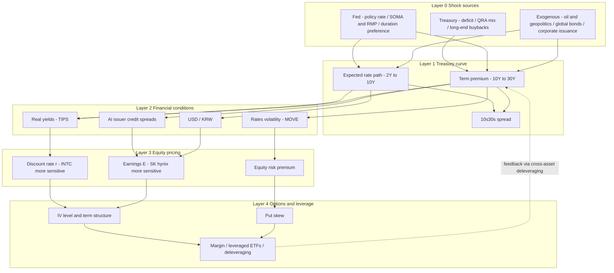

# From the Treasury Term Structure to Semiconductor Options: How Treasury Issuance, Operation Twist and the 10Y/30Y Spread Transmit to INTC, SK hynix and Their Implied Volatility

> **Author**: Hugo (independent research project) · [中文版](README_zh.md)
> **Data cut-off**: 2026-10-13 (market prices mainly as of the 2026-10-09 to 10-12 closes; see Appendix B)
> **Nature**: Qualitative macro-finance research with illustrative numerical scenarios. **Not investment advice.**

---

## How to Read This Report: Fact / Inference / Opinion Labels

To keep facts and subjective views clearly separated, three labels are used throughout:

| Label | Meaning | Example |
|---|---|---|
| **[Fact]** | Directly verifiable from official documents, company filings or market data; source given | On 2026-08-19 the Treasury raised the maximum size of each long-end buyback from $2bn to at least $4bn |
| **[Inference]** | A conclusion derived from facts plus economic mechanism; testable, but not empirically tested here | Because buybacks are funded with bills, they shorten the duration the private sector must hold |
| **[Opinion]** | The author's subjective judgement; anything with investment implications also carries "⚠️ Not investment advice" | The author believes INTC is more rate-sensitive than SK hynix |

---

## Contents

- [Executive Summary](#executive-summary)
- [Chapter 1 Mechanisms: Who Sets the Yield Curve?](#chapter-1-mechanisms-who-sets-the-yield-curve)
- [Chapter 2 History: Long-End Rate Cycles, Growth Valuations, Put Pricing and Margin](#chapter-2-history-long-end-rate-cycles-growth-valuations-put-pricing-and-margin)
- [Chapter 3 The Companies: INTC and SK hynix — Fundamentals, Rate Sensitivity and the Transmission Framework](#chapter-3-the-companies-intc-and-sk-hynix--fundamentals-rate-sensitivity-and-the-transmission-framework)
- [Chapter 4 Assumptions, Model Limitations and Tail Risks](#chapter-4-assumptions-model-limitations-and-tail-risks)
- [Chapter 5 Resume Summary, Interview Script and Follow-up Q&A](#chapter-5-resume-summary-interview-script-and-follow-up-qa)
- [Appendix](#appendix)

---

## Executive Summary

**Research question**: How do the U.S. Treasury's issuance and buybacks, and the Federal Reserve's rate and balance-sheet operations (including Operation Twist), transmit through 10Y/30Y Treasury yields and the 10s30s spread to semiconductor equities (INTC, SK hynix) and their single-stock option implied volatility?

**Context (October 2026)** [Fact]: The 10Y yield briefly reached ~5.3% (highest since 2002) and the 30Y ~5.6–5.7%; the Fed hiked to 3.75–4.00% in September; in August the Treasury doubled the size of its long-end buybacks; semiconductors fell far more than the broad market.

**Five key conclusions**:

1. **The Fed manages "expectations"; the Treasury manages "duration"** [Inference]: Long yields = expected short-rate path + term premium. The Fed mainly drives the former; the Treasury, through issuance mix and buybacks, changes the duration the private sector must absorb, and hence the latter — especially 10s30s.
2. **The 2026 curve move is a bear flattener** [Fact + Inference]: From Aug 19 to Oct 9, 10s30s narrowed from ~55bp to ~36bp. This is consistent with "Fed hikes + Treasury long-end buybacks (a mini-twist)", but this report cannot separate the two contributions.
3. ***Why* yields rise matters more than *how much*** [Inference]: Historically, long-end sell-offs driven by term premium or real yields (2022, 2023 Q3, 2026 Q3) hurt long-duration growth stocks most; semiconductors typically fall 2–3x as much as the index.
4. **The two stocks are rate-sensitive through different channels** [Opinion, ⚠️ Not investment advice]: INTC mainly through the **discount rate and its own funding cost** (~65–70x run-rate P/E, ~$50.5bn debt, notes maturing in 2066); SK hynix mainly through **earnings expectations** (HBM depends on debt-financed AI capex) while holding ~KRW 69tn of net cash.
5. **Puts get more expensive *not* because of rho** [Inference, with calculations]: A +50bp rate move makes a 30-day INTC put only ~$0.015 *cheaper*; a -8% stock move plus IV rising to 72% roughly 2.2x's the put price, raises short-put margin by ~52%, and forced covering creates a feedback loop.

**Method**: Mechanism review (official documents) + ten historical episodes + company fundamental comparison + Black-Scholes and margin scenario calculations + a five-layer qualitative transmission framework + a falsifiable empirical test design (not yet executed).

### Iteration Log

| Round | Work completed |
|---|---|
| 1 | Data collection (Treasury, Fed, company filings, market data); report structure and labeling system |
| 2 | Chapter 1: curve decomposition, 10s30s, issuance framework, auction mechanics, buybacks, Fed operations, Operation Twist, comparison table, current snapshot |
| 3 | Chapter 2: ten historical episodes, equity duration, put pricing decomposition, margin calculations, feedback loop |
| 4 | Chapter 3: INTC and SK hynix fundamentals, five sensitivity channels, scoring comparison, five-layer framework, scenario matrix, monitoring dashboard, empirical design |
| 5 | Chapter 4: assumptions, fact/opinion self-audit, model limitations, tail risks, disclaimer |
| 6 | Chapter 5: resume summary, 30-second and 2-minute scripts, 17 follow-up Q&As |
| 7 | Summary and appendix (glossary, data and timestamps, code, references) |
| 8 | Full verification: recomputed numbers, checked labels and disclaimers → **report complete, iteration stopped** |

---

## Chapter 1 Mechanisms: Who Sets the Yield Curve?

### 1.1 The Basic Decomposition of the Yield Curve

The yield on any n-year Treasury can be split into two parts (plus a usually small convexity term):

$$
y_t^{(n)} \;=\; \underbrace{\frac{1}{n}\sum_{i=0}^{n-1}\mathbb{E}_t\!\left[r_{t+i}\right]}_{\text{expected short-rate path (Fed-driven)}} \;+\; \underbrace{TP_t^{(n)}}_{\text{term premium (supply/demand, inflation uncertainty, fiscal risk)}} \;-\; \text{convexity}
$$

- **Expected path**: The market's expected average fed funds rate over the bond's life, set mainly by the policy rate and forward guidance; dominates 2Y–5Y. [Inference]
- **Term premium**: Extra compensation for bearing duration risk, driven by **duration supply** (how much long debt the Treasury issues and the Fed absorbs), inflation uncertainty, fiscal sustainability and global demand; dominates 10Y–30Y. Common estimates are the New York Fed's ACM model and the Fed Board's Kim-Wright model — **model estimates, not observable data**. [Fact]
- **Convexity**: Grows with maturity; its value pushes 30Y yields down, one reason 30Y has at times yielded less than 20Y. [Fact]

Curve moves are usually described by three factors — level, slope and curvature (Litterman–Scheinkman, 1991) — with the **level factor** explaining most of the variance. By "which end moves more", there are four shapes:

| Shape | Definition | Typical driver | Typical implication for growth stocks [Inference] |
|---|---|---|---|
| Bull steepening | Yields fall, short end more | Rising Fed cut expectations | Lower discount rate, generally positive |
| Bull flattening | Yields fall, long end more | Flight to safety, growth worries, less long-end supply | Rate benefit offset by growth fears; mixed |
| Bear steepening | Yields rise, long end more | Rising term premium, fiscal worries, more long-end supply | **Worst for long-duration growth stocks** |
| Bear flattening | Yields rise, short end more | Fed hikes | Discount rate and funding cost both rise; negative |

### 1.2 Why Study the 10s30s Spread Specifically

2s10s mainly reflects "policy-rate expectations vs medium/long rates". **Both legs of 10s30s are far from the policy rate**, so it more cleanly reflects: [Inference]

1. **Ultra-long term premium**: fiscal-sustainability fears show up first in the 30Y;
2. **Ultra-long supply and demand**: pension and insurance liability-driven investors (LDI) are natural 30Y buyers; weaker foreign official demand or more long-end issuance raises 30Y relative yields;
3. **Treasury/Fed duration operations**: Operation Twist, long-end buybacks and the suspension of 30Y issuance all act directly on this segment.

For equities, the 10Y is the standard discount-rate benchmark, while the 30Y links directly to ultra-long corporate funding (Intel issued notes maturing as late as 2066 in Q2 2026; see 3.1). **10s30s is therefore a key intermediate variable linking Treasury/Fed duration operations to long-term cost of capital.** [Inference]

### 1.3 The Treasury: Issuance Framework and Auction Mechanics

#### 1.3.1 Issuance framework: "regular and predictable"

- The core principle of Treasury debt management is to be **"regular and predictable"**: avoid changing issuance opportunistically and avoid surprising the market. [Fact]
- **Quarterly Refunding Announcement (QRA)**: Each quarter the Treasury publishes borrowing estimates and then coupon auction sizes, informed by recommendations from the **Treasury Borrowing Advisory Committee (TBAC)**, made up of dealers and investors. [Fact]
- The 2026-08-05 QRA [Fact]: $125bn offered (3Y $58bn, 10Y $42bn, 30Y $25bn) to refund ~$96.3bn of maturing debt, **raising ~$28.7bn of new cash**. Treasury expects to keep coupon and FRN sizes unchanged "**for at least the next several quarters**" and noted it is monitoring **SOMA bill purchases** and growing private demand for bills. Next QRA: **2026-11-04**.

| Planned auction sizes, Aug–Oct 2026 ($bn) | 2Y | 3Y | 5Y | 7Y | 10Y | 20Y | 30Y | FRN |
|---|---|---|---|---|---|---|---|---|
| Aug | 69 | 58 | 70 | 44 | 42 | 16 | 25 | 28 |
| Sep | 69 | 58 | 70 | 44 | 39 | 13 | 22 | 28 |
| Oct | 69 | 58 | 70 | 44 | 39 | 13 | 22 | 30 |

*Source: U.S. Treasury Quarterly Refunding Statement, 2026-08-05. [Fact]*

[Inference] With coupon sizes "frozen", seasonal and unexpected funding gaps are filled with **T-bills** and cash management bills (CMBs), so incremental funding is short-duration — itself a form of "protection" for the long end.

#### 1.3.2 How a Treasury auction works

| Element | Key mechanics [Fact] |
|---|---|
| Format | **Single-price (uniform-price) auction**, often loosely called a "Dutch auction": all winning bidders receive the same highest accepted yield (High Yield) |
| Competitive bids | Specify yield and amount; a single bidder may be awarded at most **35%** of the offering (35% rule) |
| Non-competitive bids | No yield specified; accept the final yield; up to **$10 million** per bidder, filled first |
| Bidder types | **Primary dealers** (obliged to bid at reasonable prices; the "backstop"); **direct bidders** (domestic institutions bidding for themselves); **indirect bidders** (via agents such as the NY Fed — including foreign central banks and large asset managers) |
| Key metrics | **Bid-to-cover**; **tail** = high yield minus the when-issued yield at the 1:00 pm ET deadline (positive = weaker than expected); **primary dealer share** (higher = weaker end-demand) |
| Fed participation | The Fed **cannot bid competitively for new issues**; it can only roll maturing SOMA holdings into new issues as non-competitive "add-ons" |

**Example: the 2026-10-08 30-year bond reopening** [Fact, verified against official Treasury FiscalData auction data]

- $22bn sold at **5.618%**, the highest since August 2000;
- Bid-to-cover **2.54** (recent average ~2.41, third-party); of competitive awards, indirect bidders took **72.3%**, direct **20.9%**, primary dealers only **6.8%** (computed from official data);
- Official data do not include the when-issued yield at the deadline, so **the tail cannot be computed from official data**; third-party commentary rated it "in line" with a near-zero tail.

[Inference] This suggests that around 5.6% **end-demand still exists**: the rise in long yields is not an "auction failure" but mainly a repricing of rate expectations and term premium — important for assessing tail risk (Chapter 4).

#### 1.3.3 Buybacks: the Treasury's "mini-twist"

- The Treasury restarted regular buybacks in 2024, in two forms: **liquidity-support buybacks** (buying less-liquid off-the-run securities) and **cash-management buybacks** (buying short maturities to smooth its cash balance). [Fact]
- Aug–Oct 2026 plan: up to $38bn of liquidity-support buybacks and up to $25bn of 1-month to 2-year cash-management buybacks. [Fact]
- On **2026-08-19**, the Treasury raised the maximum size of each buyback in the 10–20Y and 20–30Y sectors **from $2bn to at least $4bn**, effective Sept 9 through Nov 4, citing a desire to "provide greater liquidity support in longer-dated nominal sectors". [Fact]
- Market reaction: on the day, 30Y fell ~9bp to 5.196% and 10Y ~5bp to 4.647%; 2s30s narrowed from 112bp to 102bp (Robeco). Robeco estimates annualized buybacks of ~**$66bn**, about **15%** of gross 20–30Y issuance. [Fact]
- Robeco also notes the buybacks will likely be funded with extra bill issuance, are far smaller than the Fed's 2011–12 Operation Twist (over $600bn), and that **the Treasury cannot create reserves** as the Fed can. [Fact]

[Inference] "Issue bills → buy back long bonds" leaves the private sector with **less long-duration and more short-duration paper** — the same direction as Operation Twist, but smaller, differently funded and framed as "liquidity support". This report calls it the Treasury's "mini-twist".

### 1.4 The Fed: Policy Rates, the Balance Sheet and Operation Twist

#### 1.4.1 The policy-rate corridor (FOMC, 2026-09-16) [Fact]

- Fed funds target raised 25bp to **3.75%–4.00%** (unanimous 12–0), the first hike since 2023; Chair **Kevin Warsh**.
- Interest on reserve balances (IORB) **3.90%**; Standing Repo Facility (SRF) rate **4.00%**; overnight reverse repo (ON RRP) rate **3.75%**.
- Dot plot: 16 of 18 participants expect at least one more 25bp hike this year; next meeting **Oct 27–28**.
- The minutes show some participants want to "**limit the Federal Reserve's footprint in the Treasury market**" when addressing market dysfunction.

#### 1.4.2 The balance sheet [Fact]

- Quantitative tightening (QT) ended in December 2025; the Fed then bought bills via **reserve management purchases (RMPs)**, starting around $40bn a month and stepping down to ~$25bn and ~$10bn; **by the September FOMC RMPs were paused**, with decisions made monthly.
- The Fed's July Monetary Policy Report shows SOMA bought nearly $250bn of bills since early 2026.
- Robeco notes Warsh prefers **shortening the duration of the Fed's holdings** and has set up a task force to review balance-sheet policy, possibly shifting reinvestments to shorter maturities.

[Inference] If the Fed shifts its holdings toward the short end while the Treasury buys back long bonds, the two move in **opposite directions** on duration: the Fed hands duration back to the market, the Treasury takes it out. That policy inconsistency is itself a source of term-premium uncertainty.

#### 1.4.3 Two historical Operation Twists

| Item | 1961 "Operation Twist/Nudge" | 2011–2012 Maturity Extension Program (MEP) |
|---|---|---|
| Context | Under Bretton Woods, keep short rates up to prevent gold/capital outflows while lowering long rates to support investment | At the zero lower bound, ease further without expanding the balance sheet |
| Operation | Fed and Treasury coordinated: Fed bought long/sold short; Treasury adjusted issuance | Announced Sept 2011: sell $400bn of ≤3Y, buy 6–30Y; extended June 2012 by $267bn — about **$667bn** total |
| Balance sheet | Size broadly unchanged | Size unchanged; **only maturity composition changed** |
| Estimated effect | Swanson (2011): long yields down ~15bp | Academic and Fed estimates mostly 10–20bp; debated |

*[Fact] operations; [Inference] effect estimates depend on event-study methodology and are indicative only.*

**Core logic** [Inference]: Operation Twist does not change total reserves; it lowers the term premium by **reducing the long-duration assets held by the private sector** (the portfolio-balance channel). It therefore acts mainly on 10Y–30Y and typically **narrows 10s30s (flattens the curve)**.

### 1.5 Fed vs Treasury: One Comparison Table

| Dimension | Federal Reserve | U.S. Treasury |
|---|---|---|
| Mandate | Maximum employment and price stability (dual mandate) | Finance the government at the lowest cost over time |
| Main tools | Policy-rate corridor; QE/QT; Operation Twist; RMPs; SRF | QRA issuance mix (coupons vs bills); auction sizes; buybacks; cash balance (TGA) |
| Funding | **Creates reserves** (can expand its balance sheet) | **Must borrow** (buybacks funded by bills) |
| Main segment affected | Short end (rates) + whole curve (balance sheet) | Term premium, especially 10Y–30Y |
| Bank reserves | QE adds, QT drains | A rising TGA drains reserves |
| Primary market | Cannot bid competitively for new issues | The issuer |
| 2026 example | 25bp hike in Sept; RMPs paused; Warsh favors shorter duration | Coupon sizes frozen; long-end buybacks doubled; QRA on Nov 4 |

**Unified view** [Inference]: What matters for the term premium is the **net duration supply the private sector must absorb**:

$$
\text{Private-sector net duration supply} \approx \text{Duration issued by Treasury} - \text{Duration absorbed by Fed} - \text{Duration bought back by Treasury}
$$

Both institutions act on the same variable with different objective functions. That is why distinguishing them matters: **a fall in long yields driven by the Fed usually comes with easier financial conditions; one driven by the Treasury shortening issuance may come with more rollover risk and concerns about Fed independence** (Robeco also notes shorter funding raises rollover risk and could be seen as pressuring the Fed).

### 1.6 Curve Snapshot, October 2026

| Indicator (close, 2026-10-09) | Value | Nature |
|---|---|---|
| 2Y | 4.80% | [Fact] |
| 10Y | 5.24% (5.31% close on Oct 5, ~5.35% intraday, highest since 2002; ~4.19% at the start of the year) | [Fact] |
| 30Y | 5.60% (closing high 5.67% on Oct 7; ~5.70% intraday) | [Fact] |
| 20Y | 5.65% (**above the 30Y: 20s30s inverted by ~5bp**, reflecting convexity and LDI demand for 30Y) | [Fact] |
| 2s10s | +44bp | [Fact, computed] |
| **10s30s** | **+36bp** (Aug 19 close: 10Y 4.65%, 30Y 5.19%, ~+54bp) | [Fact, computed] |
| 10Y TIPS real yield | ~2.94% (~1.90% at the start of the year) | [Fact] |

**Drivers** (Forbes, Cato and others): [Fact]

1. **Fiscal**: CBO projects an FY2026 deficit of ~$1.9tn (5.8% of GDP), with net interest above $1tn;
2. **Inflation and energy**: refining capacity knocked out by the Iran conflict lifted CPI to ~3.4% and September inflation expectations to 4.6%;
3. **Fed hikes**: the September hike with more tightening signaled;
4. **Global bond sell-off**: Japan's 10Y at 3.11% (three-decade high); UK gilt yields at their highest since 2008;
5. **Corporate supply**: ~$489bn of AI-related tech borrowing.

**Key observations** [Inference]:

- From Aug 19 to Oct 9, the 10Y rose ~59bp and the 30Y ~40bp; **10s30s narrowed from ~55bp to ~36bp — a bear flattener**. This fits "Fed hikes pushing the belly + Treasury buybacks capping the ultra-long end", but this report **cannot separate the two** (see Chapter 4).
- The Cato Institute notes that essentially all of September's rise in the 10Y came from **real yields**, not inflation expectations. For equity valuations, a rise in real yields is more damaging than a rise in expected inflation (see 2.2).

### Chapter Summary

1. Long yields = rate expectations + term premium; the Fed mainly drives the former, the Treasury affects the latter through duration supply.
2. 10s30s is the cleanest window on "duration operations"; the 2026 bear flattener reflects both Fed hikes and Treasury buybacks.
3. The October 2026 30Y auction showed normal demand around 5.6%; the long-end rise looks more like "repricing" than "buyers disappearing". [Opinion]

---

## Chapter 2 History: Long-End Rate Cycles, Growth Valuations, Put Pricing and Margin

### 2.1 Ten Historical Long-End Rate / Spread Shocks

> Note: figures are rounded approximations of public market data, used to illustrate mechanisms — **not a precise backtest**. Curve shapes and driver attributions are [Inference].

| # | Period | Curve shape | 10Y move (approx.) | 10s30s / long-end feature | Main driver | Growth / semiconductor performance (approx.) |
|---|---|---|---|---|---|---|
| 1 | Feb–Nov 1994 | Bear flattening | 5.2% → 8.0% | Whole curve up | Fed hiked from 3% to 6% (by Feb 1995); market badly underpriced hikes | S&P ~-1.5% for the year; Orange County bankruptcy, Mexican peso crisis, forced unwinds of leveraged bond positions |
| 2 | Oct 31, 2001 | Bull flattening (ultra-long) | — | 30Y fell 30bp+ in one day | **Treasury suspended 30Y issuance** | Classic supply shock: a change in expected long-end supply can reshape 10s30s in a day |
| 3 | Sep 2011–Dec 2012 | Bull flattening | ~2.0% → 1.4–1.8% | 10s30s narrowed | **Fed MEP / Operation Twist** (~$667bn) | Euro crisis capped risk appetite; rate relief did not fully translate into equity gains |
| 4 | May–Sep 2013 | Bear steepening | 1.6% → 3.0% | Term premium jumped | Bernanke signaled QE tapering ("Taper Tantrum") | U.S. stocks fell ~6% then recovered; **EM capital outflows**, KRW and KOSPI under pressure |
| 5 | Oct–Dec 2018 | Bear flattening, then bull | Peak ~3.24% (Nov) | Real yields up | Fed hikes + QT on "autopilot" | Nasdaq down ~24% from the Aug high to Dec 24; memory cycle also turning down |
| 6 | 2022 | Bear flattening (2s10s inverted) | 1.5% → ~4.2% (Oct peak) | 10s30s compressed to very narrow | Fastest hikes in 40 years; 10Y real yield from ~-1% to ~+1.7% | Nasdaq -33%; Philadelphia Semiconductor Index ~-36%; **INTC ~-49%**; SK hynix ~-40% |
| 7 | Aug–Oct 2023 | **Bear steepening** | ~4.0% → 5.0% | 30Y above 5.1%; term premium turned positive | **August QRA raised coupon sizes** + Fitch downgrade | Nasdaq-100 down ~11%; **sharp rally after the Nov 1 QRA slowed long-end increases** |
| 8 | Sep 2024–Jan 2025 | Bear steepening | 3.6% → 4.8% | Long end up | Fed cut 100bp, but term premium and fiscal worries rose | Shows "cuts ≠ lower long yields"; long-duration growth stocks diverged |
| 9 | Apr 2025 | Bear steepening + liquidity shock | ~4.0% → 4.5% in a week | 30Y near 5%; swap spreads deeply negative | Tariff shock + **basis-trade deleveraging** | VIX closed above 50; semis fell sharply; INTC briefly below $18 |
| 10 | Aug–Oct 2026 | **Bear flattening** | ~4.65% → 5.24% (peak ~5.3%) | 10s30s ~55bp → 36bp | Fed hikes + oil + deficit; **Treasury doubled long-end buybacks** | INTC from 52-week high of $142.35 to ~$101 (~-29%); on Oct 8, SOXX -2% vs QQQ -0.6% |

**Patterns across the ten episodes** [Inference]:

1. **"Why" matters more than "how much".** Rate rises driven by growth expectations (e.g., late 2013) did limited damage; rises driven by **term premium, real yields or inflation** (2022, 2023 Q3, 2026 Q3) hurt long-duration growth stocks most.
2. **Treasury issuance decisions alone can move the long end.** Episodes 2, 7 and 10 show QRAs and buyback announcements are event risks independent of the FOMC.
3. **Semiconductors typically fall 2–3x as much as the index**: high beta, cyclicality and "long-duration narratives" stack up (see 3.3).
4. **Liquidity shocks amplify everything** (episodes 1, 9): when the Treasury market itself deleverages, rates, equities and volatility all move the wrong way together.

### 2.2 How Higher Long Yields Compress Growth Valuations

#### 2.2.1 Equity duration: the simplest model

Using the Gordon growth model $P = \dfrac{E_1}{r-g}$, where $r$ = risk-free rate + equity risk premium, the derivative with respect to $r$ gives "equity duration":

$$
D_{equity} = -\frac{\partial P / P}{\partial r} = \frac{1}{r-g}
$$

**Numerical example** (author's calculation; assumed parameters, illustrative only):

| Company type | r | g | Equity duration | r +50bp | r +100bp |
|---|---|---|---|---|---|
| High growth, earnings far in the future (INTC-like "foundry revival" narrative) | 9.5% | 6.0% | 28.6 yrs | **-12.5%** | **-22.2%** |
| High-margin, low-multiple cyclical (SK hynix-like current state) | 11.0% | 2.0% | 11.1 yrs | -5.3% | -10.0% |

[Inference] The intuition: **the further out the earnings, the smaller r − g, and the more sensitive the price is to the discount rate.** That is why, within semiconductors, "story stocks" are more 10Y-sensitive than "cash cows".

#### 2.2.2 Three corrections: why reality is messier

1. **Real vs nominal rates**: Equities are claims on real assets and are more sensitive to **real rates** over the long run. In 2026 the 10Y TIPS yield rose from ~1.90% to ~2.94%; Cato argues September's rise came almost entirely from real yields — the worst combination for valuations. [Fact + Inference]
2. **r and g are not independent**: If rates rise because the economy is stronger, g also rises, offsetting some valuation pressure. The Gordon model holds g fixed and so **overstates** rate sensitivity (see Chapter 4). [Inference]
3. **The stock–bond correlation can flip**: In low-inflation regimes, stocks and Treasuries are usually negatively correlated (Treasuries hedge equities); in high-inflation or fiscal-stress regimes they are often **positively correlated** (both fall), as in 2022. 2026 looks more like the latter. [Inference]

#### 2.2.3 What is special about semiconductors: rates hit "E", not just "r"

[Inference] For AI-linked semiconductors, long-end rates also affect earnings expectations through **customers' capital spending**:

- In 2026, hyperscalers rely heavily on bond issuance to fund AI capex: one tally shows ~**$220bn** issued through Aug 10; UBS forecasts $270–290bn for the year. [Fact]
- AI-related issuer credit spreads are ~**115bp**, wider than ~78bp for the broad investment-grade market; hyperscaler bond cover ratios fell from ~5x in February to ~2x in July. [Fact]
- On 2026-10-12, Broadcom CEO Hock Tan and Intel CEO Lip-Bu Tan both said in Singapore that **capital** — not chips or power — may become the biggest bottleneck for AI expansion; Lip-Bu Tan cited rising cost of capital and uncertain returns. [Fact]

The chain is therefore: **30Y up → long-dated corporate funding costs up → higher hurdle rates for AI projects → slower capex growth at the margin → lower semiconductor order and pricing expectations.** For SK hynix (HBM revenue highly dependent on AI capex) this channel may matter more than the discount-rate channel (see 3.2).

### 2.3 How Higher Long Yields Affect Put Pricing

#### 2.3.1 A counter-intuitive starting point: higher rates alone make puts *cheaper*

Under Black-Scholes, put rho is negative: higher rates → higher forward price $F = S e^{rT}$ → lower expected put payoff. But for short-dated options the effect is **tiny**.

**Numerical example** (author's calculation; INTC spot $101.35, 30-day $95-strike put, IV 60%, risk-free 3.9%):

| Scenario | Put price | Change vs base | Main Greek |
|---|---|---|---|
| Base | $3.91 | — | — |
| Rates +50bp only | $3.89 | **-$0.015** | Rho (direct effect; negligible and *negative*) |
| IV 60% → 70% only | $4.95 | +$1.04 | Vega |
| Stock -8% only | $7.19 | +$3.29 | Delta / Gamma |
| **Combined: stock -8%, IV to 72%, rates +50bp** | **$8.45** | **~2.2x** | All three |

For the SK hynix ADR (SKHY, spot $162.23, 30-day $150-strike put, IV 62%), a "stock -10%, IV to 75%" scenario lifts the put from ~$5.82 to ~$14.45, about **2.5x**.

[Inference] Conclusion: **long-end rates affect put prices mainly not through rho but through "rates → stock falls (delta) + volatility rises (vega) + skew steepens".** This is a strong differentiating point in interviews (see 5.3).

#### 2.3.2 The four channels that actually matter [Inference]

1. **Spot–vol correlation**: Implied volatility usually rises when stocks fall, more so for high-beta single names like semis than for indices.
2. **Skew steepening**: During rate shocks, the market pays more for downside protection; OTM puts get pricier relative to ATM. SKHY's 25-delta skew was about -0.027 in late August, i.e., downside tail already carried a premium. [Fact, third-party data]
3. **Term-structure inversion**: Around clustered events (FOMC Oct 27–28, SK hynix earnings ~Oct 27, INTC earnings ~Oct 29, QRA Nov 4), short-dated IV tends to exceed longer-dated IV. [Fact: calendar; Inference: term structure]
4. **Rates-vol spillover**: Rising rates volatility (MOVE index) often leads or accompanies rising equity volatility (VIX), because it raises uncertainty about discount rates and tightens leveraged investors' risk budgets.

#### 2.3.3 Current implied volatility levels (reference)

| Underlying | IV reference | Implied 30-day 1-sigma move | Source note |
|---|---|---|---|
| INTC | 30-day IV ~58–65% (various sources, Aug–Oct) | ~±17% (at 60%) | Third-party options data, inconsistent timestamps [Fact] |
| SKHY | ~172% in launch week; ~62% ATM in late August | ~±18% (at 62%) | Third-party options data [Fact] |

[Inference] Both IVs are around 60%, meaning the market already prices monthly moves of ±17–18%. **In a high-IV environment, buying puts to hedge rate risk is itself expensive** — which is why Chapter 4 asks how much is "already priced in".

### 2.4 Margin Pressure: How Leverage Amplifies Rate Shocks

#### 2.4.1 Equity and options accounts

- **Reg T**: 50% initial margin on stock; FINRA minimum maintenance 25%, with brokers typically setting higher "house" requirements for volatile names (e.g., 30–50% or more). [Fact]
- **Common margin formula for a short naked put** (simplified CBOE rule):
  $$\text{Margin} = \max\big(20\%\times S - \text{OTM amount},\; 10\%\times K\big) + \text{option market value}$$
- **Portfolio margin**: based on stress scenarios (typically ±15% price shocks for single stocks plus volatility shifts); more sensitive to IV increases, so margin calls arrive faster when volatility rises. [Fact]

**Numerical example** (author's calculation, continuing the INTC scenario in 2.3.1; 100 shares per contract):

| Item | Before shock | After shock (stock -8%, IV 72%) | Change |
|---|---|---|---|
| Margin on 1 short $95 put | ~$1,783 | ~$2,710 | **~+52%** |
| Mark-to-market loss | — | ~$454 | — |

For a short SKHY $150 put under a similar scenario, margin rises from ~$2,604 to ~$4,365 (+68%).

[Inference] Put sellers collecting premium face "losses + higher margin" simultaneously in a rate shock; forced covering (buying back puts) pushes put prices and IV higher still, creating a **positive feedback loop**.

#### 2.4.2 The Treasury-market side

[Inference, partly based on historical facts]

- **Higher futures margins**: When rates volatility rises, exchanges raise Treasury futures margins, forcing leveraged positions to shrink.
- **Basis trade**: Hedge funds "long cash bonds + short futures", financed in repo at high leverage; if repo costs or margins jump, concentrated unwinds push long yields up (similar dynamics in March 2020 and April 2025).
- **Cross-asset deleveraging**: Multi-strategy funds, risk-parity and volatility-targeting funds mechanically cut equity exposure as volatility rises.

#### 2.4.3 Semiconductor-specific leverage amplifiers

- **Single-stock leveraged ETFs**: e.g., ProShares' 2x SK hynix ETF (SKHU). These rebalance daily and **sell into the close** on big down days. [Fact: product exists; Inference: rebalancing effect]
- **Korean retail margin loans**: Korean individuals' margin buying ("신용융자") triggers broker forced liquidations ("반대매매") in sell-offs, adding pressure to SK hynix's local shares. [Inference]

### 2.5 Chapter Summary: A Positive Feedback Loop

```text
Long-end yields ↑ (term premium / real yields)
   │
   ├─→ Discount rate ↑ → long-duration growth valuations ↓ ──┐
   ├─→ AI capex funding cost ↑ → earnings expectations ↓ ────┤
   │                                                          ▼
   │                                     Stock ↓ + IV ↑ + skew steepens
   │                                                          │
   │                                                          ▼
   │                    Margin ↑ / leveraged-ETF rebalancing / risk-parity de-risking
   │                                                          │
   └──────────── Treasury futures margin ↑ ← cross-asset deleveraging ←┘ (loop closes)
```

1. Long-end rates compress growth stocks mainly through **real yields and term premium**; "why" rates rise determines "how much damage".
2. The direct rate effect on puts (rho) is small; what really lifts put prices is **falling stocks, rising IV and steeper skew**.
3. Margin and leveraged products can turn a rate shock into a liquidity shock, most visibly in high-IV semiconductor names.

---

## Chapter 3 The Companies: INTC and SK hynix — Fundamentals, Rate Sensitivity and the Transmission Framework

### 3.1 Intel (INTC): From "Turnaround" to "Long-Duration Narrative Stock"

#### 3.1.1 Fundamental snapshot [Fact]

| Item | Data | Note |
|---|---|---|
| Q2 2026 revenue | $16.1bn, +25% YoY | Above top of guidance ($13.8–14.8bn) |
| Non-GAAP gross margin | 41.8% (GAAP 40.4%) | ~280bp above guidance |
| EPS | Non-GAAP $0.42; **GAAP -$2.16** | Large gap between the two bases |
| Data Center & AI (DCAI) | $6.3bn, +59% YoY | Company says demand exceeds supply |
| Intel Foundry | Revenue $5.8bn; **operating loss $2.1bn** | External revenue only $293m (~5%) |
| 18A process | Output +50%+ QoQ; yields ahead of internal targets | Limited external validation |
| Q3 guidance | Revenue $15.8–16.8bn; non-GAAP EPS $0.38 | Earnings expected late October (reported as Oct 29) |
| 2026 capex | Raised to **>$20bn**, higher in 2027 | Previously ~$18bn |
| Total debt | **~$50.5bn** (2026-06-27) | ~$46.6bn at end-2025 |
| Cash & short-term investments | ~$29.7bn | ~$37.4bn at end-2025 |
| New notes in Q2 | $6.5bn in five tranches maturing **2031–2066** | Longest: 40 years |
| Price / market cap | ~$101 / ~$536bn (2026-10-12) | 52-week range $32.89–142.35; ~$37 at start of year |
| Strategic holders | U.S. government ~10% (Aug 2025); Nvidia $5bn (Sep 2025); SoftBank $2bn | — |
| Recent event | Musk said his companies will build and run Terafab; Intel's role undecided | On Oct 8 INTC fell more than NVDA and AMD |

#### 3.1.2 Five channels of rate sensitivity

1. **Valuation duration (high)** [Inference]: Annualizing Q3 non-GAAP EPS guidance of $0.38 (~$1.50) puts the stock at roughly **65–70x run-rate earnings** (author's rough estimate, ignoring growth). The market is pricing **distant earnings** from 18A/14A foundry success; r − g is small, matching the "long-duration" profile in 2.2.1.
2. **Funding cost (high)** [Inference]: Intel is capital-heavy with net debt (~$20.8bn, debt minus cash), capex above $20bn, and **has just issued notes maturing in 2066**. Its marginal long-term funding cost is the 30Y Treasury yield plus a credit spread, so 10s30s and the 30Y level matter directly for its cost of capital.
3. **Demand side (medium)** [Inference]: Data-center CPU demand benefits from AI inference and agent workloads, but tighter funding for hyperscaler capex can affect order timing.
4. **Positioning and momentum (high)** [Inference]: Up more than 200% at one point in 2026, a crowded "recovery trade"; on rate-shock days (e.g., Oct 8) it fell more than peers, consistent with "crowded trades get cut first".
5. **Policy backstop (partial offset)** [Opinion]: U.S. government ownership and CHIPS Act subsidies create a partial "policy floor" that may reduce extreme tail risk, but do not change the valuation's sensitivity to rates. ⚠️ Not investment advice

### 3.2 SK hynix: An AI Memory Leader at a Cyclical Peak

#### 3.2.1 Fundamental snapshot [Fact]

| Item | Data | Note |
|---|---|---|
| Q2 2026 revenue | ~KRW 79.32tn (~$55.2bn) | Record high |
| Operating profit | ~KRW 60.54tn; **operating margin 76%** | 72% in Q1, 41% a year earlier |
| vs expectations | Below consensus (~KRW 64tn) | Stock fell 9.6% on the day; HBM4 shipments slower than expected |
| Net profit | ~KRW 93.92tn | Includes ~KRW 63.27tn of investment gains (non-recurring) |
| HBM | HBM4 mass shipments began in Q2, big ramp in H2; early-2026 market share ~56% (single source) | Long-term agreements with ~10 customers |
| Nvidia partnership | SK Group initiative announced 2026-07-25, headline value >$500bn | Not a memory-only contract value |
| Balance sheet | Cash ~KRW 88tn; debt ~KRW 18.6tn; **net cash ~KRW 69.4tn** | Extremely strong |
| 2026 capex | "High-40 trillion won" range (2025: ~KRW 30.2tn) | Target capex/sales ~mid-30% (3-year rolling) |
| U.S. ADR | Listed on Nasdaq 2026-07-10 (SKHY) at $149, raising $26.5bn; **10 ADRs = 1 common share** | Listed options since Jul 14 |
| Price / valuation | SKHY ~$162 (Oct 12 close); trailing P/E ~9.9x | ~-5% pre-market Oct 13 on CXMT progress |
| Local market | KOSPI 6,803.90 and KRW 1,340.4/USD (Oct 7) | Foreigners net sold KRW 2.61tn that day |

#### 3.2.2 Five channels of rate sensitivity

1. **Valuation duration (medium-low)** [Inference]: A ~10x P/E implies a ~10% earnings yield; r − g is large and Gordon duration is short. But note: **cyclicals trade at their lowest P/E at peak margins** — the market is already pricing a margin decline.
2. **Earnings expectations "E" (high — most important)** [Inference]: HBM revenue depends heavily on hyperscaler AI capex, which increasingly relies on debt (see 2.2.3). Higher long yields and AI credit spreads → slower capex growth → pressure on HBM pricing and long-term-agreement terms. For SK hynix, **rates act first through E, not r**.
3. **Funding cost (low)** [Inference]: With ~KRW 69tn net cash, higher rates actually increase interest income.
4. **FX and cross-border flows (medium, but atypical in 2026)** [Inference]: The textbook logic is "U.S. yields ↑ → USD ↑ → EM outflows → KOSPI down". But in 2026 the won *strengthened* from ~1,414.8 in August to ~1,340.4 in early October, **contrary to that logic**. FX channels can be overridden by AI-related inflows and local policy (one of the limitations in Chapter 4).
5. **Dual-listing timing (a new channel)** [Inference]: SKHY reacts to U.S. Treasury yields and U.S. options-market shocks **first**, during U.S. hours; Korean local shares catch up at the next open. Since the ADR listing, U.S. rate shocks may transmit to SK hynix faster than before.

### 3.3 Rate-Sensitivity Comparison

> Scores (1 = low, 5 = high) are [Opinion], based on the qualitative analysis above; not regression-tested. ⚠️ Not investment advice

| Channel | INTC | SK hynix | Explanation |
|---|---|---|---|
| Valuation duration (r) | **5** | 2 | INTC's value is mostly distant earnings; SK hynix's current earnings are high |
| Earnings (E) dependence on AI capex funding | 3 | **5** | HBM is the most direct beneficiary of AI capex |
| Own funding cost | **4** | 1 | INTC net debt + heavy capex; SK hynix net cash |
| FX / cross-border flows | 1 | 3 | KRW channel exists but atypical in 2026 |
| Crowding and leveraged products | 4 | 4 | Both have high IV, leveraged ETFs and retail leverage |
| Idiosyncratic (non-rate) risk | Terafab, 18A external customers | CXMT competition, HBM4 qualification timing | — |
| **Overall rate sensitivity** | **High (mainly via r and funding)** | **Medium-high (mainly via E)** | — |

### 3.4 The Qualitative Transmission Framework (Core Contribution)

#### 3.4.1 Five-layer transmission map



#### 3.4.2 Scenario matrix: expected reactions under four curve regimes

> Everything below is [Opinion] — qualitative reasoning from the framework, not a forecast. ⚠️ Not investment advice

| Scenario | Example trigger | INTC | SK hynix | IV / skew |
|---|---|---|---|---|
| **Bear steepening** (term-premium driven) | QRA raises long-end issuance; downgrade; widening auction tails | Worst: valuation + funding hit together | Negative: tighter AI funding → E revised down | IV up, put skew clearly steeper |
| **Bear flattening** (Fed driven; current state) | Another hike; inflation surprise | Negative, partly cushioned by buybacks | Neutral to negative | IV up moderately; term structure inverts before events |
| **Bull steepening** (cut expectations) | Weak jobs, dovish Fed | Biggest beneficiary: long duration recovers | Benefits, unless AI demand is also slowing | IV down, skew normalizes |
| **Bull flattening** (risk-off / recession) | AI bubble fears, sharp growth slowdown | Rate relief offset by growth fears | **Worst**: E downgrades dominate | IV up; stock–bond correlation turns negative |

#### 3.4.3 Monitoring dashboard

| Layer | Indicator | Why it matters | Key upcoming dates |
|---|---|---|---|
| Shock source | QRA sizes and buyback plans; auction tails and indirect share | Most direct term-premium signal | **QRA: Nov 4** |
| Shock source | FOMC decision and dot plot | Expected rate path | **FOMC: Oct 27–28** |
| Curve | 10s30s; ACM term premium | Separates "expectations-driven" from "term-premium-driven" moves | Daily |
| Financial conditions | 10Y TIPS; AI issuer spreads; hyperscaler bond cover ratios | Discount-rate channel and E channel | Daily / each deal |
| Financial conditions | MOVE index; USD/KRW | Vol spillover and cross-border flows | Daily |
| Options | INTC and SKHY 30-day IV; 25-delta skew; IV term structure | Price the market pays for downside protection | **Earnings: SK hynix ~Oct 27, INTC ~Oct 29** |

#### 3.4.4 Extensible empirical test design (not yet executed)

To turn the qualitative framework into falsifiable hypotheses, the following tests could be run (**not executed in this report; results unknown**):

1. **Rate-decomposition regression**: split daily 10Y changes into an "expectations" part and a "term premium" part (ACM model), and estimate
   $$R_{i,t} = \alpha + \beta_1 \Delta \mathbb{E}[r]_t + \beta_2 \Delta TP_t + \beta_3 \Delta(10s30s)_t + \gamma R_{mkt,t} + \varepsilon_t$$
   Hypothesis H: INTC's $|\beta_2|$ is significantly larger than SK hynix's.
2. **Event study**: use QRA days, 10Y/30Y auction days and the buyback-increase announcement as event windows; test cumulative abnormal returns and IV changes.
3. **Volatility spillover**: regress $\Delta IV_{i,t}$ on $\Delta MOVE_t$ and the stock's own return to test the marginal explanatory power of rates vol.
4. **ADR lead-lag**: test whether SKHY's U.S.-session return predicts SK hynix's next-day Korean return.

### Chapter Summary

1. **INTC's rate sensitivity comes mainly from r and funding**: high valuation, net debt, ultra-long issuance, crowded positioning.
2. **SK hynix's rate sensitivity comes mainly from E**: low valuation and net cash, but earnings depend heavily on debt-financed AI capex.
3. The five-layer framework links "Treasury/Fed operations → curve → financial conditions → stock prices → options and leverage" into a monitorable, testable chain.

---

## Chapter 4 Assumptions, Model Limitations and Tail Risks

### 4.1 Research Assumptions

| ID | Assumption | Basis | Consequence if false |
|---|---|---|---|
| H1 | Medium-term moves in 10Y–30Y yields are driven mainly by **term premium**, not rate expectations | 2026 rise in real yields, fiscal deficit, curve reaction to buybacks | If driven by expectations, the Fed (not the Treasury) is the key variable |
| H2 | Treasury issuance mix and buybacks affect 10s30s **independently of the FOMC** | 2001 30Y suspension; Aug and Nov 2023 QRAs; Aug 2026 buyback announcement | If the effect is small, the "Treasury mini-twist" narrative fails |
| H3 | Long-duration growth stocks are more sensitive to **real yields** than to inflation expectations | Gordon model; 2022 experience | If inflation expectations matter as much, breakevens must be added |
| H4 | INTC is affected mainly via **r and funding**, SK hynix mainly via **E** | Chapter 3 fundamental comparison | If false, the 3.3 scores must be redone |
| H5 | Rate shocks lift put prices via **falling stocks, rising IV and steeper skew**, not via rho | Black-Scholes decomposition (2.3.1) | Mathematically close to certain; magnitude depends on spot–vol correlation |
| H6 | Margin and leveraged products **amplify** rate shocks | 1994, 2020, 2025 experience | If leverage is low, amplification is limited |

### 4.2 The Boundary Between Fact and Opinion (Self-Audit)

| Conclusion | Nature | Basis of credibility |
|---|---|---|
| Aug 2026 QRA sizes, buyback increase, FOMC hike, rate corridor | [Fact] | Official Treasury and Fed documents |
| 10Y and 30Y yield levels; 30Y auction results | [Fact] | Verified against official Treasury yield curve and auction data (intraday figures still from media) |
| INTC and SK hynix financials | [Fact] | Company releases, SEC filings, major media |
| Option IV and skew | [Fact, lower confidence] | Third-party options websites; inconsistent timestamps |
| "Treasury buybacks = mini-twist" | [Inference] | Duration-supply logic; Robeco explicitly notes major differences |
| 10s30s bear flattening attributed to hikes + buybacks | [Inference] | No decomposition done; contributions cannot be separated |
| 3.3 sensitivity scores, 3.4.2 scenario matrix | [Opinion] | Qualitative judgement, not regression-tested |

### 4.3 Model Limitations

1. **The Gordon model overstates rate sensitivity**: it assumes g is independent of r and constant forever. In reality, if higher rates come with upgraded growth, valuation pressure is partly offset; empirical "effective equity duration" is usually far below 1/(r − g).
2. **Black-Scholes assumptions**: constant volatility, lognormal returns, no jumps, no transaction costs. Semiconductor single names have earnings jumps and pronounced skew; BS is used only for **directional decomposition**, not exact pricing. The IV changes in 2.3 are assumptions, not model outputs.
3. **Simplified margin calculations**: real margin depends on broker house rules, portfolio-margin models and concentration add-ons; numbers in 2.4 only illustrate magnitude.
4. **Causal identification**: rates and stock prices are often driven by **common shocks** (e.g., oil lifts yields and hits tech at the same time). The case studies show "correlation + mechanism", not causation.
5. **Small sample, large structural change**: ten episodes over 30+ years, during which policy frameworks, market structure (0DTE options, leveraged ETFs, basis-trade size) and the semiconductor industry (AI cycle) changed fundamentally.
6. **SKHY's history is too short**: the ADR listed only in July 2026; about three months of options data gives no reliable historical reference for whether IV is "high" or "low".
7. **Inconsistent data timestamps**: some market data come from third-party aggregators and may differ from official data by 1–2 trading days or in definition (close vs intraday).
8. **The term premium is unobservable**: ACM and Kim-Wright estimates can differ materially and depend on model specification.

### 4.4 Tail Risks

#### 4.4.1 Upside rate tails (bad for both stocks)

| Risk | Transmission [Inference] | Early warning signs |
|---|---|---|
| Clearly weak long-end auctions | Large tails + high dealer share → term-premium jump → bear steepening | 30Y/10Y tails > 2–3bp; sharp drop in indirect share |
| Further U.S. downgrade or fiscal rules breaking down | Term-premium repricing; stocks and bonds fall together | Rating outlook changes; upward deficit revisions |
| Doubts about Fed independence / fiscal dominance | Inflation expectations and term premium rise together | Breakevens and term premium rising in tandem |
| Middle East escalation (e.g., Strait of Hormuz disrupted) | Oil → inflation → hike expectations → bear flattening | Brent, gasoline crack spreads |
| Concentrated basis-trade unwind | Cash-bond selling → long-end spike → cross-asset deleveraging | Swap spreads plunging; repo spikes; futures margin hikes |
| Japanese repatriation | Japan's 10Y already 3.11%; Japanese investors cut Treasuries | Yen; Japanese life insurers' allocation plans |

#### 4.4.2 Downside rate tails (not necessarily good news)

| Risk | Transmission [Inference] |
|---|---|
| **AI capex cycle peaks / bubble bursts** | Yields fall (bull flattening) but SK hynix's E is cut sharply and INTC's AI narrative suffers — **rates down and stocks down** |
| Recession | Stock–bond correlation turns negative; IV spikes; put skew becomes extreme |
| Financial repression / yield-curve control | Long end administratively capped, but inflation and dollar risk shift to other assets |
| Treasury shifts heavily to bills | Long end lower short term, but higher rollover risk and future rate sensitivity |

#### 4.4.3 Idiosyncratic tails (unrelated to rates, but can stack on a rate shock)

- **INTC**: 18A/14A yields or external customers disappoint; smaller Terafab role; governance and policy uncertainty from government ownership.
- **SK hynix**: HBM4 qualification or shipment delays (already seen in Q2); Chinese competitors such as CXMT catching up; renegotiation of long-term agreements; export controls and geopolitical risk.
- **Options microstructure**: gamma squeezes from concentrated short-dated options, leveraged-ETF rebalancing into the close, liquidity drying up around earnings.

### 4.5 Disclaimer

> This report is an independent academic research project by the author, for learning and job-application purposes only. All data come from public sources; the author does not guarantee completeness or accuracy. **Any content about market direction, individual stock performance or trading strategy is the author's personal opinion and ⚠️ does not constitute investment advice**, and should not be used as a basis for buying or selling any security or derivative. Options and leveraged products are very high risk and can lose all of the principal or more.

---

## Chapter 5 Resume Summary, Interview Script and Follow-up Q&A

### 5.1 Resume Project Summary

**One-paragraph version (~60 words)**

> **Treasury Term Structure and Semiconductor Options | Independent Research | Sep–Oct 2026**
> Independently researched how U.S. Treasury issuance, buybacks and Fed operations (incl. Operation Twist) transmit through the 10s30s curve to semiconductor stocks. Reviewed 10 long-end rate shocks (1994–2026), built a five-layer transmission framework for INTC and SK hynix, and used Black-Scholes to quantify how rate shocks reprice puts and margin.

**Three-bullet version**

- Built a five-layer qualitative framework linking U.S. Treasury issuance, buybacks and Fed balance-sheet policy to the 10s30s curve, financial conditions, semiconductor equity valuation (INTC, SK hynix) and single-stock option implied volatility.
- Reviewed 10 long-end rate episodes (1994–2026) and decomposed put repricing with Black-Scholes, showing the direct rho effect of a +50bp shock is ~-$0.02 while spot and vol effects raise put value ~2.2x.
- Separated fact, inference and opinion throughout; documented assumptions, model limitations, tail risks and a falsifiable empirical test design (ACM term-premium regressions, event studies around QRAs and auctions).

### 5.2 Interview Scripts

#### Version A: 30-second elevator pitch

> "I did an independent research project on how U.S. Treasury issuance and Fed operations transmit through the 10-year/30-year Treasury spread to semiconductor stocks and their option prices. My main finding is that the two stocks I studied are rate-sensitive in different ways: Intel mainly through the discount rate and its own funding cost, SK hynix mainly through earnings expectations tied to AI capex. I also showed with Black-Scholes that higher rates by themselves make puts slightly *cheaper* — puts get expensive because stocks fall and volatility rises."

#### Version B: 2-minute version (STAR)

> **Situation**: "In October 2026 the 10-year Treasury yield hit about 5.3%, the highest since 2002, and the 30-year was near 5.7%. Semiconductors fell much more than the Nasdaq. I wanted to understand whether this was a Fed story or a Treasury story, and how it reaches individual stocks and their options."
>
> **Task**: "I set three goals: explain the mechanics of Treasury issuance, auctions, buybacks and the Fed's Operation Twist; use historical episodes to see how higher long rates affect growth stocks, put pricing and margin; and build a testable transmission framework for Intel and SK hynix."
>
> **Action**: "I split long yields into rate expectations and term premium, and argued the Fed mainly drives the first while the Treasury drives the second through duration supply. In August 2026 the Treasury doubled its long-end buybacks, and afterward 10s30s narrowed from about 55 to about 36 basis points. That looks like a mini Operation Twist, but I noted it is much smaller than the 2011 program and funded by bills. I reviewed ten long-end shocks from 1994 to 2026. At the company level I compared valuation, debt and demand drivers, and ran Black-Scholes scenarios: a 50bp rate rise makes a put only about 2 cents cheaper, but an 8% drop with IV at 72% makes it 2.2 times as expensive and raises short-put margin about 52%."
>
> **Result**: "The output is a five-layer framework — shock sources, the Treasury curve, financial conditions, equity pricing, options and leverage — with a monitoring dashboard and a regression design for next steps. I labeled every claim as fact, inference or opinion, and wrote up the limitations — for example, the Gordon model overstates rate sensitivity, and I can't yet separate the effect of Fed hikes from Treasury buybacks."

### 5.3 Likely Follow-up Questions and Model Answers

**Q1: What is the difference between Operation Twist and QE?**

> QE means the Fed **expands its balance sheet** to buy long bonds, adding bank reserves. Operation Twist **does not expand the balance sheet** — the Fed sells short-dated and buys long-dated securities, changing only the maturity mix. Both lower the term premium by reducing the duration held by the private sector, but Twist adds no reserves. The 2011–12 MEP was about $667bn.

**Q2: Is a Treasury buyback the same as Operation Twist?**

> The direction is similar: the Treasury issues bills and buys back long bonds, so the private sector holds less duration. But there are three differences: it is much smaller (~$66bn annualized vs $600bn+); the Treasury cannot create reserves and must borrow; and the stated goal is liquidity support, not monetary policy. That's why I call it a "mini-twist" and label it as an inference.

**Q3: Why focus on 10s30s instead of the more common 2s10s?**

> The short leg of 2s10s is dominated by the policy rate, so it mostly reflects Fed expectations. Both legs of 10s30s are far from the policy rate, so it better captures ultra-long term premium, pension demand and long-end supply — exactly where Treasury and Fed duration operations act. For companies, the 30Y also links directly to ultra-long corporate debt; Intel just issued notes maturing in 2066.

**Q4: In theory, what happens to a put when rates rise? Why do puts usually get more expensive in practice?**

> In theory put rho is negative: higher rates raise the forward price, so the put gets cheaper. But rho is tiny for short-dated options — in my example +50bp makes the put only about $0.015 cheaper. In practice puts get pricier because the rate shock also makes the stock fall (delta), implied volatility rise (vega) and skew steepen; those effects are far larger than rho.

**Q5: How do you tell whether a Treasury auction was weak?**

> Three metrics: the tail (high yield minus the when-issued yield at the deadline; the bigger the positive tail, the weaker), bid-to-cover (below the recent average is weak), and the primary-dealer share (higher means weaker end-demand). The Oct 8, 2026 30-year auction cleared at 5.618% with a 2.54 bid-to-cover, above average, and dealers took only 6.8% — normal or even solid.

**Q6: How is the term premium measured, and what are the problems?**

> The common models are the New York Fed's ACM model and the Fed Board's Kim-Wright model; both use affine term-structure models to split yields into expectations and term premium. The problem is that the term premium is not directly observable: estimates can differ a lot across models and are sensitive to sample and specification, so they are a reference, not a fact.

**Q7: Why is Intel more rate-sensitive than Nvidia?**

> Three reasons (opinion, ⚠️ not investment advice): first, Intel's valuation depends on foundry success several years out, so its earnings are further away and its equity duration is longer; second, Intel builds its own fabs, has net debt and over $20bn of capex, so its funding cost is directly tied to long rates, while Nvidia is asset-light; third, Intel rallied hugely in 2026 and is crowded, so it gets sold first in rate shocks. On Oct 8 Intel fell about 5% and Nvidia about 1%, consistent with this — but one day doesn't prove causation.

**Q8: SK hynix trades at about 10x earnings. Why is it still rate-sensitive?**

> A low P/E means the discount-rate channel is weak, but SK hynix's risk is in earnings: HBM revenue depends heavily on hyperscaler AI capex, which is increasingly debt-financed. Higher long rates and credit spreads raise hurdle rates for AI projects and can slow capex and HBM pricing. Also, cyclicals have their lowest P/E at peak margins — the low multiple itself shows the market is pricing a margin decline.

**Q9: Why can't the Fed buy Treasuries directly at auction?**

> The Federal Reserve Act requires the Fed to buy and sell Treasuries in the open (secondary) market, to prevent the central bank from directly financing deficits. The only exception is rolling maturing holdings into new issues pro rata as add-ons, which are not competitive bids.

**Q10: In late 2024 the Fed cut 100bp. Why did the 10-year yield go up?**

> Because long yields = rate expectations + term premium. Cuts lowered the expectations part, but fiscal worries, inflation uncertainty and supply pressure raised the term premium, and markets may have worried that early cuts would mean higher future inflation. That shows "cuts" don't equal "lower long yields", and it's why I study the Fed and the Treasury separately.

**Q11: Why can the stock–bond correlation flip from negative to positive, and what does that mean for your framework?**

> In low-inflation regimes most shocks are demand shocks: stocks fall and Treasuries rally, so they are negatively correlated. In high-inflation or fiscal-stress regimes the shocks come from inflation and term premium, so stocks and bonds fall together — 2022 and 2026 look more like that. It means Treasuries hedge equity portfolios less well, and demand for equity option protection rises.

**Q12: How does margin amplify a sell-off? Give an example.**

> Take one short Intel $95 put. Under a simplified CBOE formula, margin is about $1,783 before the shock; if the stock drops 8% and IV rises to 72%, margin rises to about $2,710 and there's a ~$454 mark-to-market loss. If the investor is forced to close, they must buy back the put, pushing put prices and IV higher — a feedback loop. Basis-trade deleveraging in the Treasury market works the same way.

**Q13: How did you keep the report objective?**

> Three things: every conclusion is labeled fact, inference or opinion; facts come from primary sources where possible (Treasury, Fed, company filings), and third-party data are flagged as lower confidence; and there is a separate chapter on limitations and tail risks — including that I can't separate hikes from buybacks and that the Gordon model overstates sensitivity.

**Q14: How could your framework be falsified?**

> I designed four tests: decompose 10Y moves with the ACM model and regress returns on them to see whether Intel's term-premium beta is significantly larger than SK hynix's; event studies around QRAs and auctions; test whether the MOVE index explains single-stock IV; and test whether SKHY's U.S.-session return predicts the next-day Korean return. If Intel turns out insensitive to term premium, H4 fails.

**Q15: If you redid the project, what would you improve?**

> I'd run the empirical tests first, turning the qualitative framework into quantitative results; use ACM term premium to decompose the Aug–Oct 2026 curve move and try to separate hikes from buybacks; and get fuller options history to use real IV surfaces instead of assumed values.

**Q16: Based on your framework, how do you see the two stocks now?**

> (⚠️ Personal opinion, not investment advice.) I focus on events rather than direction: the Oct 27–28 FOMC, both companies' earnings, and the Nov 4 QRA. If the QRA shortens issuance further, long-end term premium could fall, relatively helping a long-duration stock like Intel; if AI issuer credit spreads keep widening, I'd worry more about SK hynix's earnings expectations. With IV already around 60%, buying puts as a hedge is costly and needs to be weighed.

**Q17: Why do you say the KRW channel was "atypical" in 2026?**

> The textbook logic is higher U.S. yields → stronger dollar → EM outflows. But from August to early October 2026, U.S. yields rose while the won *strengthened* from about 1,415 to about 1,340. That suggests AI-related inflows and other factors outweighed the rate-differential effect, so I down-weighted the FX channel and listed it as a limitation.

---

## Appendix

### Appendix A: Glossary

| Term | Explanation |
|---|---|
| Term premium | Extra compensation for holding a long bond versus rolling short bills |
| Operation Twist / MEP | Fed sells short and buys long without expanding its balance sheet |
| QRA | Treasury's quarterly announcement of borrowing needs and coupon issuance plans |
| Uniform-price auction | All winners receive the same highest accepted yield |
| Tail | High yield minus the when-issued yield at the bidding deadline |
| Bid-to-cover | Total bids / amount offered |
| RMP | Reserve management purchases: Fed bill buying to keep reserves "ample" |
| Bear steepening / flattening | When yields rise, the long / short end rises more |
| Equity duration | Sensitivity of a stock price to the discount rate; 1/(r − g) in the Gordon model |
| Implied volatility (IV) | Volatility backed out of option market prices |
| Skew | IV differences across strikes; steeper put skew = pricier downside protection |
| Rho / Vega / Delta | Option price sensitivity to rates / volatility / the underlying price |
| Portfolio margin | Margin set by the maximum loss under stress scenarios |
| Basis trade | Long cash Treasuries + short Treasury futures, financed with leveraged repo |
| ADR | American Depositary Receipt; for SKHY, 10 ADRs = 1 common share |

### Appendix B: Key Data and Timestamps

| Data | Value | Date | Source |
|---|---|---|---|
| 2Y / 10Y / 30Y | 4.80% / 5.24% / 5.60% | 2026-10-09 close | **U.S. Treasury daily par yield curve (official)** |
| 10Y peak | 5.31% (Oct 5 close, official); ~5.35% intraday | 2026-10-05 to 10-07 | U.S. Treasury, CNBC |
| 10Y TIPS | ~2.94% | 2026-10-07 | Forbes |
| 30Y reopening | $22bn at 5.618%, bid-to-cover 2.54; indirect 72.3% / direct 20.9% / dealers 6.8% | 2026-10-08 | **Treasury FiscalData auction data (official)** |
| August QRA | $125bn; ~$28.7bn new cash | 2026-08-05 | U.S. Treasury |
| Long-end buyback increase | $2bn → at least $4bn per operation | Announced 08-19, effective 09-09 | U.S. Treasury |
| Fed funds rate | 3.75%–4.00%; IORB 3.90% | 2026-09-16 | Federal Reserve |
| INTC price | ~$101.35 | 2026-10-12 | Morningstar, 24/7 Wall St. |
| SKHY price | ~$162.23 | 2026-10-12 close | Motley Fool |
| INTC Q2 results | Revenue $16.1bn, etc. | Released 2026-07-23 | Intel, SEC |
| SK hynix Q2 results | Revenue ~KRW 79.32tn, etc. | Released 2026-07-29 | SK hynix, Investing.com |
| KOSPI / KRW | 6,803.90 / 1,340.4 | 2026-10-07 | The Korea Times |

### Appendix C: Code (reproduces the numbers in 2.2, 2.3 and 2.4)

```python
from math import log, sqrt, exp
from statistics import NormalDist
N = NormalDist().cdf

def bs_put(S, K, T, r, s):
    d1 = (log(S/K) + (r + 0.5*s*s)*T) / (s*sqrt(T))
    d2 = d1 - s*sqrt(T)
    return K*exp(-r*T)*N(-d2) - S*N(-d1)

def short_put_margin(S, K, prem):  # simplified CBOE rule, 100 shares per contract
    otm = max(S - K, 0)
    return max(0.20*S - otm, 0.10*K) * 100 + prem * 100

# Gordon-model equity duration
for r, g in [(0.095, 0.06), (0.11, 0.02)]:
    print(1/(r-g), (r-g)/(r+0.005-g) - 1, (r-g)/(r+0.01-g) - 1)

# INTC: S=101.35, K=95, 30 days, IV 60%, r=3.9%
S, K, T = 101.35, 95, 30/365
base  = bs_put(S, K, T, 0.039, 0.60)        # ≈ 3.91
r_up  = bs_put(S, K, T, 0.044, 0.60)        # ≈ 3.89 (rho effect)
shock = bs_put(S*0.92, K, T, 0.044, 0.72)   # ≈ 8.45
print(base, r_up, shock, shock/base)
print(short_put_margin(S, K, base), short_put_margin(S*0.92, K, shock))  # ≈ 1783 → 2710
```

### Appendix D: References

**Official documents**

- [U.S. Treasury: Quarterly Refunding Statement, August 2026](https://home.treasury.gov/news/press-releases/sb0590)
- [U.S. Treasury: Increased Sizes of Long-End Liquidity Support Buybacks (2026-08-19)](https://home.treasury.gov/news/press-releases/sb0607)
- [Federal Reserve: FOMC Minutes, September 15–16, 2026](https://www.federalreserve.gov/monetarypolicy/fomcminutes20260916.htm)
- [Federal Reserve: Monetary Policy Report, July 2026](https://www.federalreserve.gov/monetarypolicy/files/20260710_mprfullreport.pdf)
- [Intel: Second-Quarter 2026 Financial Results](https://www.intc.com/news-events/press-releases/detail/1776/intel-reports-second-quarter-2026-financial-results)
- [Intel: Q2 2026 Form 10-Q (SEC)](https://www.sec.gov/Archives/edgar/data/0000050863/000005086326000157/intc-20260627.htm)
- [SK hynix: Lists ADRs on NASDAQ](https://news.skhynix.com/en/skhynix-lists-adrs-on-nasdaq/)

**Research and media**

- [Robeco: US Treasury steps in as long-end yields rise](https://www.robeco.com/en-int/insights/2026/08/us-treasuries-buyback-and-impact-on-the-fed-and-markets)
- [Forbes: 10-Year Treasury Yield Hits Highest Level Since 2002](https://www.forbes.com/sites/garthfriesen/2026/10/07/why-the-10-year-treasury-yield-just-hit-a-24-year-high/)
- [CNBC: 10-year Treasury yield hits highest level since 2002](https://www.cnbc.com/amp/2026/10/07/treasury-yields-auction-fomc-minutes.html)
- [CNBC: Fed rate decision September 2026](https://www.cnbc.com/2026/09/16/fed-rate-decision-september-2026.html)
- [Cato Institute: Persistently Higher Treasury Yields](https://www.cato.org/blog/persistently-higher-treasury-yields-could-add-trillions-debt-over-10-years)
- [24/7 Wall St.: Intel Slides as Chip Stocks Sell Off With Yields and Oil Higher](https://247wallst.com/investing/2026/10/08/intel-slides-3-as-chip-stocks-sell-off-with-yields-and-oil-higher-nvidia-and-amd-slip/)
- [CNBC: Intel, Broadcom CEOs warn capital crunch could become AI bottleneck](https://www.cnbc.com/2026/10/12/intel-broadcom-ceos-warn-capital-crunch-could-become-ai-bottleneck.html)
- [Investing.com: SK hynix Q2 2026 slides](https://www.investing.com/news/company-news/sk-hynix-q2-2026-slides-record-revenue-76-operating-margin-93CH-4818489)
- [Quartz: SK Hynix Q2 2026 earnings miss estimates](https://qz.com/sk-hynix-q2-2026-earnings-record-profit-misses-estimates-072926)
- [Saxo: SK Hynix options debut](https://www.home.saxo/content/articles/options/options-brief---cool-cpi-sk-hynix-options-debut---15-july-2026-15072026)
- [U.S. Treasury: Daily Par Yield Curve Rates (official)](https://home.treasury.gov/resource-center/data-chart-center/interest-rates/TextView?type=daily_treasury_yield_curve&field_tdr_date_value=2026)
- [Treasury FiscalData: Treasury Securities Auctions Data (official)](https://fiscaldata.treasury.gov/datasets/treasury-securities-auctions-data/)
- [TFTC: 30-Year Treasury Bond Auction (third-party data)](https://www.tftc.io/treasury-auctions/30-year-bond)
- [The Korea Times: Seoul stocks fall as foreign profit-taking weighs (2026-10-07)](https://www.koreatimes.co.kr/economy/20261007/seoul-stocks-fall-as-foreign-profit-taking-samsung-earnings-caution-weigh-on-investor-sentiment)

**Academic literature**

- Litterman, R. & Scheinkman, J. (1991). *Common Factors Affecting Bond Returns*. Journal of Fixed Income.
- Swanson, E. (2011). *Let's Twist Again: A High-Frequency Event-Study Analysis of Operation Twist and Its Implications for QE2*. Brookings Papers on Economic Activity.
- Adrian, T., Crump, R. & Moench, E. (2013). *Pricing the Term Structure with Linear Regressions*. Journal of Financial Economics. (ACM term-premium model)
- Kim, D. & Wright, J. (2005). *An Arbitrage-Free Three-Factor Term Structure Model and the Recent Behavior of Long-Term Yields and Distant-Horizon Forward Rates*. FEDS Working Paper.

---

*Completed 2026-10-13. ⚠️ Nothing in this report constitutes investment advice.*
