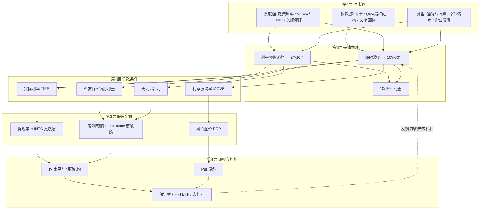

# 从美债期限结构到半导体期权：财政部发债、扭转操作与 10Y/30Y 利差对 INTC、SK hynix 及其隐含波动率的传导研究

> **作者**：Hugo（独立研究项目）· [English](README.md)
> **数据截止**：2026-10-13（市场价格以 2026-10-09 至 10-12 收盘为主，具体见附录 B）
> **研究性质**：宏观金融定性研究 + 情景化数值示例；**不构成任何投资建议**

---

## 阅读说明：事实 / 推断 / 观点标注体系

为满足"客观区分事实与主观观点"的要求，全文使用三类标签：

| 标签 | 含义 | 举例 |
|---|---|---|
| **【事实】** | 可由官方文件、公司披露或市场数据直接核实的陈述，附来源 | 财政部 2026-08-19 宣布长端回购单次上限由 20 亿美元提高至至少 40 亿美元 |
| **【推断】** | 基于事实与经济学机制推导出的结论，逻辑可检验，但未经本文实证 | 回购资金来自短债发行，因而在私人部门层面缩短了久期供给 |
| **【观点】** | 作者主观判断，含不确定性；涉及投资含义的一律附加"⚠️不构成投资建议" | 作者认为 INTC 的利率敏感性高于 SK hynix |

---

## 目录

- [摘要](#摘要)
- [第 1 章 机制篇：谁在决定收益率曲线？](#第-1-章-机制篇谁在决定收益率曲线)
- [第 2 章 历史篇：长端利率周期、成长股估值、Put 定价与保证金](#第-2-章-历史篇长端利率周期成长股估值put-定价与保证金)
- [第 3 章 标的篇：INTC 与 SK hynix 的基本面、利率敏感性与传导框架](#第-3-章-标的篇intc-与-sk-hynix-的基本面利率敏感性与传导框架)
- [第 4 章 研究假设、模型局限与尾部风险](#第-4-章-研究假设模型局限与尾部风险)
- [第 5 章 简历摘要、面试口述脚本与追问问答](#第-5-章-简历摘要面试口述脚本与追问问答)
- [附录](#附录)

---

## 摘要

**研究问题**：美国财政部的发债与回购、美联储的利率与资产负债表操作（包括扭转操作），如何通过 10Y/30Y 美债收益率与利差，传导到半导体股（INTC、SK hynix）及其个股期权隐含波动率？

**背景（2026 年 10 月）**【事实】：10Y 收益率一度升至约 5.3%（2002 年以来最高），30Y 约 5.6%–5.7%；美联储 9 月加息至 3.75%–4.00%；财政部 8 月将长端回购单次上限翻倍；半导体板块跌幅明显大于大盘。

**五个主要结论**：

1. **美联储管"预期"，财政部管"久期"**【推断】：长端收益率 = 利率预期 + 期限溢价。美联储主要影响前者；财政部通过发行结构与回购影响私人部门需要吸收的久期，从而影响后者，尤其是 10s30s。
2. **2026 年的曲线是"熊平"**【事实 + 推断】：8 月 19 日至 10 月 9 日，10s30s 由约 55bp 收窄至约 36bp。方向上与"加息 + 财政部长端回购（小型扭转）"一致，但本文无法区分两者各自的贡献。
3. **"为什么涨"决定"伤害多大"**【推断】：历史上由期限溢价、实际利率推动的长端上行（2022、2023 Q3、2026 Q3）对长久期成长股伤害最大；半导体跌幅通常是大盘的 2–3 倍。
4. **两只股票的利率敏感渠道不同**【观点，⚠️不构成投资建议】：INTC 主要经**折现率与融资成本**（约 65–70 倍运行率市盈率、约 505 亿美元债务、2066 年到期票据）；SK hynix 主要经**盈利预期**（HBM 依赖靠发债融资的 AI 资本开支），自身净现金约 69 万亿韩元。
5. **Put 变贵不是因为 rho**【推断，附计算】：利率 +50bp 只让 INTC 30 天期 put 便宜约 0.015 美元；股价 -8% 叠加 IV 升至 72%，put 价格约变为 2.2 倍，卖 put 保证金上升约 52%，并通过平仓形成正反馈。

**方法**：机制梳理（官方文件）＋ 十个历史案例 ＋ 公司基本面对比 ＋ Black-Scholes 与保证金情景计算 ＋ 五层定性传导框架 ＋ 可证伪的实证检验设计（尚未执行）。

---

### 本报告的迭代记录

| 轮次 | 完成内容 |
|---|---|
| 第 1 轮 | 数据检索（财政部、美联储、公司财报、市场数据），搭建报告结构与标注体系 |
| 第 2 轮 | 第 1 章：曲线分解、10s30s、发债框架、拍卖机制、回购、美联储操作、扭转操作、对照表、当前快照 |
| 第 3 轮 | 第 2 章：十个历史案例、股票久期、put 定价分解、保证金计算、正反馈回路 |
| 第 4 轮 | 第 3 章：INTC 与 SK hynix 基本面、五渠道敏感性、对比评分、五层框架、情景矩阵、监测面板、实证设计 |
| 第 5 轮 | 第 4 章：研究假设、事实/观点自我审计、模型局限、尾部风险、免责声明 |
| 第 6 轮 | 第 5 章：简历摘要（中英）、30 秒与 2 分钟口述脚本、17 个追问问答 |
| 第 7 轮 | 摘要、附录（术语表、数据来源与时间戳、计算代码、参考资料） |
| 第 8 轮 | 全文核查：数字复算、标注检查、免责声明检查 → **报告完成，停止迭代** |

---

## 第 1 章 机制篇：谁在决定收益率曲线？

### 1.1 收益率曲线的基本分解

任何期限 n 的国债收益率都可以拆成两块（附加一个通常较小的凸性项）：

$$
y_t^{(n)} \;=\; \underbrace{\frac{1}{n}\sum_{i=0}^{n-1}\mathbb{E}_t\!\left[r_{t+i}\right]}_{\text{预期短端利率路径（美联储主导）}} \;+\; \underbrace{TP_t^{(n)}}_{\text{期限溢价（供需、通胀不确定性、财政风险）}} \;-\; \text{凸性调整}
$$

- **预期路径**：市场对未来联邦基金利率的平均预期，主要由美联储政策利率与前瞻指引决定，对 2Y–5Y 影响最大。【推断】
- **期限溢价（Term Premium）**：投资者为承担久期风险所要求的额外补偿，主要受**久期供给**（财政部发多少长债、美联储吸收多少）、通胀不确定性、财政可持续性和全球资金需求影响，对 10Y–30Y 影响最大。常用估计为纽约联储的 ACM 模型与美联储理事会的 Kim-Wright 模型，两者都依赖模型设定，是**估计值而非观测值**。【事实】
- **凸性**：期限越长凸性越大，30Y 的凸性价值会压低其收益率，这是 30Y 收益率在某些时期低于 20Y 的原因之一。【事实】

曲线变化通常用"水平、斜率、曲率"三因子描述（Litterman–Scheinkman, 1991），其中**水平因子**解释了国债收益率变动的大部分方差。按照"谁动得更多"，可以把曲线移动分为四种：

| 形态 | 定义 | 典型驱动 | 对成长股的典型含义【推断】 |
|---|---|---|---|
| 牛陡（Bull Steepening） | 整体下行，短端降得更多 | 美联储降息预期升温 | 折现率下降，偏利好 |
| 牛平（Bull Flattening） | 整体下行，长端降得更多 | 避险、增长担忧、长端供给减少 | 利率利好被增长担忧抵消，分化 |
| 熊陡（Bear Steepening） | 整体上行，长端升得更多 | 期限溢价上升、财政担忧、长端供给增加 | **最不利于长久期成长股** |
| 熊平（Bear Flattening） | 整体上行，短端升得更多 | 美联储加息 | 折现率和融资成本同时上升，偏利空 |

### 1.2 为什么单独研究 10Y/30Y 利差（10s30s）

2s10s 主要反映"政策利率预期 vs 中长期利率"，而 **10s30s 两端都远离政策利率**，它更干净地反映了：【推断】

1. **超长端期限溢价**：财政可持续性担忧会首先体现在 30Y；
2. **超长端供需**：养老金与保险公司的负债驱动投资（LDI）是 30Y 的天然买方；外国官方需求减弱、财政部长端发行增加会抬升 30Y 相对收益率；
3. **财政部/美联储的久期干预**：扭转操作、长端回购、暂停 30Y 发行都直接作用于这一段。

对股票而言，10Y 是最常用的折现基准，而 30Y 与超长期限的公司债融资（例如英特尔 2026 年 Q2 发行了最长至 2066 年到期的票据，见 3.1）直接相关。因此，**10s30s 是连接"财政/美联储久期操作"与"长期限资本成本"的关键中间变量**。【推断】

### 1.3 财政部：发债框架与拍卖机制

#### 1.3.1 发债框架："常规且可预测"

- 财政部债务管理的核心原则是**"常规且可预测"（regular and predictable）**：尽量不以择时为目的改变发行，避免给市场带来意外。【事实】
- **季度再融资公告（QRA）**：每季度先公布融资需求估算，随后公布中长期附息券的发行规模，并参考由一级交易商等组成的**国债借款咨询委员会（TBAC）**的建议。【事实】
- 2026 年 8 月 5 日 QRA【事实】：发行 1,250 亿美元（3Y 580 亿、10Y 420 亿、30Y 250 亿），用于偿还约 963 亿美元到期债务，**新增私人部门融资约 287 亿美元**；财政部表示预计"**至少未来几个季度**"维持附息券与 FRN 发行规模不变，并提到正在关注**美联储 SOMA 购买短债**及私人部门对短债需求的增长。下一次 QRA 定于 **2026-11-04**。

| 2026 年 8–10 月计划发行规模（十亿美元） | 2Y | 3Y | 5Y | 7Y | 10Y | 20Y | 30Y | FRN |
|---|---|---|---|---|---|---|---|---|
| 8 月 | 69 | 58 | 70 | 44 | 42 | 16 | 25 | 28 |
| 9 月 | 69 | 58 | 70 | 44 | 39 | 13 | 22 | 28 |
| 10 月 | 69 | 58 | 70 | 44 | 39 | 13 | 22 | 30 |

*来源：美国财政部 2026-08-05 季度再融资声明。【事实】*

【推断】在附息券规模"冻结"的前提下，季节性和意外的融资缺口都靠**短期国债（T-bills）**和现金管理票据（CMB）来填补，这意味着增量融资的久期偏短。这本身就是一种对长端的"保护"。

#### 1.3.2 拍卖机制：一场国债拍卖是怎么完成的

| 环节 | 机制要点【事实】 |
|---|---|
| 拍卖形式 | **单一价格（统一价格）拍卖**，常被俗称为"荷兰式拍卖"：所有中标者都按同一个最高中标收益率（High Yield）获配 |
| 竞争性投标 | 报出收益率与数量；单一投标人最多获配发行量的 **35%**（35% 规则） |
| 非竞争性投标 | 不报价，接受最终收益率；每个投标人上限 **1,000 万美元**，优先全额获配 |
| 投标人类别 | **一级交易商**（有义务按合理价格参与投标，承担"兜底"角色）；**直接投标人**（自行投标的国内机构）；**间接投标人**（通过纽约联储等代理投标，包括外国央行与大型资管） |
| 关键指标 | **投标倍数（Bid-to-Cover）**；**尾差（Tail）**：最高中标收益率减去截标时（13:00 ET）的发行前（when-issued）收益率，正值说明需求弱于预期；**一级交易商获配比例**：比例越高，说明终端需求越弱 |
| 美联储参与 | 美联储**不能在一级市场竞价购买**新债；只能把到期的 SOMA 持仓按比例"滚动"为新发债券（add-on），不计入竞争性投标 |

**实例：2026-10-08 的 30 年期国债续发拍卖**【事实，已用财政部 FiscalData 官方拍卖数据核实】

- 规模 220 亿美元，中标收益率 **5.618%**，为 2000 年 8 月以来最高；
- 投标倍数 **2.54**（近期均值约 2.41，第三方数据）；竞争性获配中间接投标人 **72.3%**、直接投标人 **20.9%**、一级交易商仅 **6.8%**（官方数据计算）；
- 官方数据不含截标时的发行前收益率，因此**尾差无法用官方数据计算**；第三方评价为"符合预期"、尾差接近于零。

【推断】这说明：在 5.6% 附近，**终端需求仍然存在**，长端收益率的上行并不是"拍卖失败"导致的，而更多由利率预期与期限溢价重新定价推动。这一点对判断尾部风险很关键（见第 4 章）。

#### 1.3.3 回购（Buybacks）：财政部的"小型扭转"

- 财政部于 2024 年重启常规回购，分为**流动性支持回购**（买入不活跃的旧券）与**现金管理回购**（买入短期限债券以平滑现金余额）。【事实】
- 2026 年 8–10 月计划：流动性支持回购最高 380 亿美元，1 个月至 2 年期现金管理回购最高 250 亿美元。【事实】
- **2026-08-19**，财政部宣布将 10–20 年和 20–30 年板块的单次回购上限由 **20 亿美元提高到至少 40 亿美元**，自 9 月 9 日起执行至 11 月 4 日，并称这是为了"在长端提供更多流动性支持"。【事实】
- 市场反应：公告当日 30Y 下行约 9bp 至 5.196%，10Y 下行约 5bp 至 4.647%，2s30s 由 112bp 收窄至 102bp（Robeco 数据）。Robeco 测算，若按当前节奏持续，年化回购约 **660 亿美元**，约为 20–30 年国债总发行量的 **15%**。【事实】
- Robeco 同时指出：回购资金很可能来自额外的短债发行；且规模（约 660 亿美元/年）远小于美联储 2011–2012 年扭转操作（超过 6,000 亿美元），**财政部无法像美联储那样创造准备金**。【事实】

【推断】"发短债 → 回购长债"在私人部门层面的净效果是：**市场需要消化的长久期资产减少、短久期资产增加**，与扭转操作方向一致，但规模小、资金来源不同、且以"流动性支持"为名义。下文称之为"财政部版的小型扭转"。

### 1.4 美联储：政策利率、资产负债表与扭转操作

#### 1.4.1 政策利率走廊（2026-09-16 FOMC）【事实】

- 联邦基金目标区间上调 25bp 至 **3.75%–4.00%**（12:0 全票通过），为 2023 年以来首次加息；主席 **Kevin Warsh**。
- 准备金利率（IORB）**3.90%**；常备回购便利（SRF）利率 **4.00%**；隔夜逆回购（ON RRP）利率 **3.75%**。
- 点阵图：18 位参与者中 16 位预计年内至少再加息 25bp；下一次会议为 **10 月 27–28 日**。
- 会议纪要显示，部分参与者希望在应对市场功能失调时"**限制美联储在国债市场中的足迹**"。

#### 1.4.2 资产负债表【事实】

- 量化紧缩（QT）于 2025 年 12 月结束；随后美联储以"**准备金管理购买**"（RMP）买入短债，初始节奏约每月 400 亿美元，后逐步降至约 250 亿、100 亿美元；**截至 9 月 FOMC，RMP 已暂停**，后续逐月决定。
- 美联储 7 月《货币政策报告》显示，2026 年初以来 SOMA 已购买近 2,500 亿美元短债。
- Robeco 指出，Warsh 倾向于**缩短美联储持仓久期**，并已成立工作组重新审视资产负债表政策，可能把再投资转向更短期限的债券。

【推断】如果美联储把持仓转向短端，而财政部同时在长端回购，两者在"久期"上的方向**相反**：美联储在把久期还给市场，财政部在把久期从市场收回。这种政策不一致本身就是期限溢价的不确定性来源。

#### 1.4.3 扭转操作（Operation Twist）的两次实践

| 项目 | 1961 年 "Operation Twist/Nudge" | 2011–2012 年 到期期限延长计划（MEP） |
|---|---|---|
| 背景 | 布雷顿森林体系下要维持短端利率以防资本外流，同时压低长端以刺激投资 | 零利率下限，美联储希望在不扩表的情况下进一步放松 |
| 操作 | 美联储与财政部协同：美联储买长卖短，财政部调整发行结构 | 2011 年 9 月宣布：卖出 ≤3 年期国债 4,000 亿美元，买入 6–30 年期；2012 年 6 月追加 2,670 亿美元，合计约 **6,670 亿美元** |
| 资产负债表 | 规模基本不变 | 规模不变，**只改变久期结构** |
| 效果估计 | Swanson (2011) 估计长端利率下降约 15bp | 学术与美联储估计多在 10–20bp 量级，存在争议 |

*【事实】操作内容；【推断】效果估计依赖事件研究方法，区间仅供参考。*

**核心逻辑**【推断】：扭转操作不改变准备金总量，而是通过**减少私人部门持有的长久期资产**来压低期限溢价（"组合再平衡渠道"），因此主要作用于 10Y–30Y，常伴随 **10s30s 收窄（曲线变平）**。

### 1.5 美联储 vs 财政部：一张对照表

| 维度 | 美联储（Fed） | 财政部（Treasury） |
|---|---|---|
| 法定目标 | 充分就业与物价稳定（双重使命） | 以长期最低成本为政府融资 |
| 主要工具 | 政策利率走廊；QE/QT；扭转操作；RMP；SRF | QRA 发行结构（附息券 vs 短债）；拍卖规模；回购；现金余额（TGA） |
| 资金来源 | **创造准备金**（可以扩表） | **必须借钱**（回购需靠发短债筹资） |
| 主要影响段 | 短端（利率）+ 全曲线（资产负债表） | 期限溢价，尤其是 10Y–30Y |
| 对银行准备金 | QE 增加、QT 减少 | TGA 上升会抽走准备金 |
| 一级市场 | 不能竞价买入新债 | 是发行人 |
| 2026 年实例 | 9 月加息 25bp；RMP 暂停；Warsh 倾向缩短久期 | 附息券规模冻结；长端回购翻倍；QRA 11-04 公布 |

**统一视角**【推断】：对期限溢价真正重要的是**私人部门需要吸收的久期净供给**：

$$
\text{私人部门久期净供给} \approx \text{财政部发行的久期} - \text{美联储吸收的久期} - \text{财政部回购的久期}
$$

两家机构作用于同一个变量，但目标函数不同。这就是"区分美联储与财政部操作"的意义：**同样是长端利率下行，如果来自美联储，往往伴随宽松的金融条件；如果来自财政部缩短发行久期，则可能伴随更高的再融资风险和对美联储独立性的担忧**（Robeco 也提到缩短融资久期会增加展期风险，并可能被视为向美联储施压）。

### 1.6 2026 年 10 月的曲线快照

| 指标（2026-10-09 收盘） | 数值 | 来源性质 |
|---|---|---|
| 2Y | 4.80% | 【事实】 |
| 10Y | 5.24%（10-05 收盘 5.31%，盘中约 5.35%，2002 年以来最高；年初约 4.19%） | 【事实】 |
| 30Y | 5.60%（收盘高点 5.67%，10-07；盘中一度约 5.70%） | 【事实】 |
| 20Y | 5.65%（**高于 30Y，20s30s 倒挂约 5bp**，体现凸性与 30Y 的 LDI 需求） | 【事实】 |
| 2s10s | +44bp | 【事实，计算】 |
| **10s30s** | **+36bp**（8 月 19 日收盘 10Y 4.65%、30Y 5.19%，约 +54bp） | 【事实，计算】 |
| 10Y TIPS 实际收益率 | 约 2.94%（年初约 1.90%） | 【事实】 |

**驱动因素**（Forbes、Cato 等汇总）：【事实】

1. **财政**：CBO 预计 2026 财年赤字约 1.9 万亿美元（GDP 的 5.8%），净利息支出超过 1 万亿美元；
2. **通胀与能源**：伊朗冲突导致炼油产能受损，CPI 升至约 3.4%，9 月通胀预期升至 4.6%；
3. **美联储加息**：9 月加息并预示进一步收紧；
4. **全球债市联动**：日本 10Y 升至 3.11%（三十年高位），英国金边债收益率创 2008 年以来新高；
5. **企业供给**：约 4,890 亿美元的 AI 相关科技公司借贷。

**关键观察**【推断】：

- 8 月 19 日至 10 月 9 日，10Y 上行约 59bp，30Y 上行约 40bp，**10s30s 从约 55bp 收窄到约 36bp，属于熊平**。这与"美联储加息推动中段 + 财政部长端回购压制超长端"的组合一致，但本文**无法把两者的贡献分开**（见第 4 章局限）。
- Cato 研究所指出，9 月 10Y 的上行几乎全部来自**实际收益率**，而非通胀预期。对股票估值而言，实际利率上行比通胀预期上行更具杀伤力（见 2.2）。

### 本章小结

1. 长端利率 = 利率预期 + 期限溢价；美联储主要管前者，财政部通过久期供给影响后者。
2. 10s30s 是观察"久期操作"最干净的窗口；2026 年的熊平同时受到美联储加息和财政部回购的影响。
3. 2026 年 10 月的 30Y 拍卖在 5.6% 附近需求正常，长端上行目前更像"重新定价"，而不是"买盘消失"。【观点】

---

## 第 2 章 历史篇：长端利率周期、成长股估值、Put 定价与保证金

### 2.1 历史案例：十次长端利率/利差冲击

> 说明：下表数值为公开市场数据的近似值（取整），用于说明机制，**不是精确回测**。曲线形态与驱动因素的归纳属于【推断】。

| # | 时间 | 曲线形态 | 10Y 变动（约） | 10s30s / 长端特征 | 主要驱动 | 成长股 / 半导体表现（约） |
|---|---|---|---|---|---|---|
| 1 | 1994.02–1994.11 | 熊平 | 5.2% → 8.0% | 全曲线上移 | 美联储从 3% 加息至 6%（至 1995.02），市场严重低估加息幅度 | 标普全年约 -1.5%；橙县破产、墨西哥比索危机，杠杆债券持仓被迫平仓 |
| 2 | 2001.10.31 | 牛平（超长端） | — | 30Y 单日下行 30bp 以上 | **财政部宣布暂停发行 30 年期国债** | 典型"供给冲击"案例：长端供给预期改变可以单日重塑 10s30s |
| 3 | 2011.09–2012.12 | 牛平 | 约 2.0% → 1.4–1.8% | 10s30s 收窄 | **美联储 MEP 扭转操作**（约 6,670 亿美元） | 欧债危机压制风险偏好，利率利好未能完全转化为股票上涨 |
| 4 | 2013.05–2013.09 | 熊陡 | 1.6% → 3.0% | 期限溢价跳升 | 伯南克暗示缩减 QE（"缩减恐慌"） | 美股回撤约 6% 后恢复；**新兴市场资本外流**，韩元与 KOSPI 承压 |
| 5 | 2018.10–2018.12 | 熊平后转牛 | 峰值约 3.24%（11 月） | 实际利率上行 | 美联储加息 + 缩表"自动驾驶" | 纳斯达克自 8 月高点至 12 月 24 日回撤约 24%；存储周期同时下行 |
| 6 | 2022 全年 | 熊平（2s10s 倒挂） | 1.5% → 约 4.2%（10 月峰值） | 10s30s 压缩至很窄 | 40 年来最快加息；10Y 实际利率由约 -1% 升至约 +1.7% | 纳斯达克 -33%；费城半导体指数约 -36%；**INTC 约 -49%**；SK hynix 约 -40% |
| 7 | 2023.08–2023.10 | **熊陡** | 约 4.0% → 5.0% | 30Y 突破 5.1%，期限溢价由负转正 | **8 月 QRA 上调附息券规模** + 惠誉下调美国评级 | 纳斯达克 100 回撤约 11%；**11 月 1 日 QRA 放缓长端增发后大幅反弹** |
| 8 | 2024.09–2025.01 | 熊陡 | 3.6% → 4.8% | 长端上行 | 美联储降息 100bp，但期限溢价与财政担忧上升 | 证明"降息≠长端下行"；长久期成长股表现分化 |
| 9 | 2025.04 | 熊陡 + 流动性冲击 | 一周内约 4.0% → 4.5% | 30Y 一度接近 5%；互换利差大幅走负 | 关税冲击 + **基差交易去杠杆** | VIX 收盘一度超过 50；半导体剧烈下跌；INTC 一度跌破 18 美元 |
| 10 | 2026.08–2026.10 | **熊平** | 约 4.65% → 5.24%（峰值约 5.3%） | 10s30s 约 55bp → 36bp | 美联储加息 + 油价 + 财政赤字；**财政部长端回购翻倍** | INTC 从 52 周高点 142.35 美元回落至约 101 美元（约 -29%）；10-08 半导体 ETF SOXX 跌约 2%，QQQ 仅跌 0.6% |

**从十个案例中归纳的规律**【推断】：

1. **"为什么涨"比"涨多少"更重要**。由增长预期推动的利率上行（如 2013 年下半年经济好转）对股票伤害有限；由**期限溢价、实际利率或通胀**推动的上行（2022、2023 Q3、2026 Q3）对长久期成长股伤害最大。
2. **财政部的发行决策可以单独移动长端**。案例 2、7 和 10 都表明，QRA 和回购公告是独立于 FOMC 的事件风险。
3. **半导体的跌幅通常是大盘的 2–3 倍**。高贝塔、周期性和"长久期叙事"三者叠加（见 3.3）。
4. **流动性冲击会放大一切**（案例 1、9）：当国债市场本身出现去杠杆，利率、股票、波动率会同时向不利方向移动。

### 2.2 长端利率如何压制成长股估值

#### 2.2.1 股票久期：一个最简单的模型

用戈登增长模型 $P = \dfrac{E_1}{r-g}$，其中 $r$ = 无风险利率 + 股权风险溢价。对 $r$ 求导得到"股票久期"：

$$
D_{equity} = -\frac{\partial P / P}{\partial r} = \frac{1}{r-g}
$$

**数值示例**（作者计算，参数为假设值，仅用于说明）：

| 公司类型 | r | g | 股票久期 | r +50bp | r +100bp |
|---|---|---|---|---|---|
| 高成长、盈利在远期（类 INTC 的"代工复兴"叙事） | 9.5% | 6.0% | 28.6 年 | **-12.5%** | **-22.2%** |
| 高盈利、低估值周期股（类 SK hynix 的当前状态） | 11.0% | 2.0% | 11.1 年 | -5.3% | -10.0% |

【推断】结论很直观：**盈利越靠后，r - g 越小，对折现率越敏感**。这也是为什么同样是半导体，"故事股"比"现金牛"对 10Y 更敏感。

#### 2.2.2 三个修正：为什么真实世界没那么简单

1. **实际利率 vs 名义利率**：股票是实物资产的索取权，长期来看更受**实际利率**影响。2026 年 10Y TIPS 收益率从约 1.90% 升至约 2.94%，Cato 研究所认为 9 月的上行几乎全部来自实际利率——这对估值是最不利的组合。【事实 + 推断】
2. **r 与 g 并不独立**：如果利率上升是因为经济更强，g 也会上升，抵消一部分估值压力。戈登模型假设 g 不变，因此**高估了**利率敏感性（见第 4 章）。【推断】
3. **股债相关性会翻转**：在低通胀时期，股票与国债价格通常负相关（国债是对冲工具）；在高通胀、财政担忧时期，两者往往**正相关**（股债双杀），2022 年即是如此。2026 年的环境更接近后者。【推断】

#### 2.2.3 半导体的特殊性：利率不仅影响 "r"，还影响 "E"

【推断】对 AI 相关半导体而言，长端利率还通过**下游客户的资本开支**影响盈利预期：

- 2026 年，超大规模云厂商（hyperscalers）大量依赖发债为 AI 资本开支融资：一家机构统计截至 8 月 10 日发行约 **2,200 亿美元**，UBS 预测全年 2,700–2,900 亿美元。【事实】
- AI 相关发行人的信用利差约 **115bp**，高于整体投资级市场约 78bp；云厂商债券认购倍数从 2 月约 5 倍降至 7 月约 2 倍。【事实】
- 2026-10-12，博通 CEO 陈福阳与英特尔 CEO 陈立武在新加坡同时表示，**资本**（而非芯片或电力）可能成为 AI 扩张的最大瓶颈；陈立武提到资本成本上升与投资回报的不确定性。【事实】

因此传导链条是：**30Y 上行 → 长期限公司债成本上行 → AI 项目的门槛收益率上升 → 资本开支增速边际放缓 → 半导体订单与定价预期下修**。这一渠道对 SK hynix（HBM 收入高度依赖 AI 资本开支）可能比折现率渠道更重要（见 3.2）。

### 2.3 长端利率上行对 Put 期权定价的影响

#### 2.3.1 一个反直觉的起点：利率上升本身会让 Put 变便宜

在 Black-Scholes 框架下，put 的 rho 为负：利率上升 → 远期价格 $F = S e^{rT}$ 上升 → put 的内在价值预期下降。但这个效应在短期限期权上**非常小**。

**数值示例**（作者计算；INTC 现价 101.35 美元，30 天期 95 行权价 put，IV 60%，无风险利率 3.9%）：

| 情景 | Put 价格 | 相对基准的变化 | 主要希腊字母 |
|---|---|---|---|
| 基准 | 3.91 美元 | — | — |
| 只有利率 +50bp | 3.89 美元 | **-0.015 美元** | Rho（直接效应，几乎可忽略且方向为负） |
| 只有 IV 60% → 70% | 4.95 美元 | +1.04 美元 | Vega |
| 只有股价 -8% | 7.19 美元 | +3.29 美元 | Delta / Gamma |
| **组合：股价 -8%、IV 升至 72%、利率 +50bp** | **8.45 美元** | **约 2.2 倍** | 三者叠加 |

对 SK hynix ADR（SKHY，现价 162.23 美元，30 天期 150 行权价 put，IV 62%），在"股价 -10%、IV 升至 75%"的情景下，put 价格从约 5.82 美元升至约 14.45 美元，约 **2.5 倍**。

【推断】结论：**长端利率影响 put 价格的主要渠道不是 rho，而是"利率 → 股价下跌（delta）+ 波动率上升（vega）+ 偏斜变陡（skew）"**。面试中这是一个很好的区分点（见 5.3）。

#### 2.3.2 真正起作用的四个渠道【推断】

1. **现货-波动率负相关（spot-vol correlation）**：股价下跌时隐含波动率通常上升，个股（尤其高贝塔半导体）比指数更明显。
2. **偏斜（skew）变陡**：利率冲击期间，市场更愿意为下跌保护付费，虚值 put 相对平值 put 更贵。SKHY 在 2026 年 8 月底的 25-delta 偏斜约为 -0.027，即下行尾部已有溢价。【事实，第三方数据】
3. **期限结构倒挂**：事件密集时（FOMC 10-27/28、SK hynix 财报预计 10-27、INTC 财报预计 10-29 前后、QRA 11-04），短期 IV 会高于长期 IV。【事实：日程；推断：期限结构】
4. **利率波动率外溢**：利率波动率（MOVE 指数）上升往往领先或伴随股票波动率（VIX）上升，因为它同时抬高了折现率的不确定性和杠杆资金的风险预算。

#### 2.3.3 当前隐含波动率水平（参考）

| 标的 | IV 参考 | 隐含 30 日 1 倍标准差波动 | 来源说明 |
|---|---|---|---|
| INTC | 30 日 IV 约 58%–65%（8–10 月不同来源） | 约 ±17%（按 60% 计算） | 第三方期权数据，时点不一【事实】 |
| SKHY | 上市首周约 172%；8 月底平值 IV 约 62% | 约 ±18%（按 62% 计算） | 第三方期权数据【事实】 |

【推断】两者 IV 都处于约 60% 的高位，意味着市场已在为月度 ±17%–18% 的波动定价。**在高 IV 环境下，"买 put 对冲利率风险"的成本本身就很高**，这也是第 4 章讨论 put 定价"已反映多少"的原因。

### 2.4 保证金压力：利率冲击如何被杠杆放大

#### 2.4.1 股票与期权账户

- **Reg T**：股票初始保证金 50%；FINRA 维持保证金最低 25%，券商对高波动个股通常设定更高的"内部要求"（如 30%–50% 甚至更高）。【事实】
- **卖出裸 put 的常见保证金公式**（CBOE 规则的简化版）：
  $$\text{保证金} = \max\big(20\%\times S - \text{虚值金额},\; 10\%\times K\big) + \text{期权市值}$$
- **组合保证金（Portfolio Margin）**：基于压力情景（个股常用 ±15% 价格冲击并叠加波动率变化）计算，对 IV 上升更敏感，在波动率上升时追加保证金更快。【事实】

**数值示例**（作者计算，延续 2.3.1 的 INTC 情景，每张合约 100 股）：

| 项目 | 冲击前 | 冲击后（股价 -8%、IV 72%） | 变化 |
|---|---|---|---|
| 卖出 1 张 95 put 的保证金 | 约 1,783 美元 | 约 2,710 美元 | **约 +52%** |
| 盯市亏损 | — | 约 454 美元 | — |

对 SKHY 的 150 put，同类情景下保证金约从 2,604 美元升至 4,365 美元（+68%）。

【推断】卖 put 收权利金的投资者在利率冲击中会同时面对"亏损 + 保证金上升"，被迫平仓（买回 put）会进一步推高 put 价格和 IV，形成**正反馈**。

#### 2.4.2 国债市场一侧

【推断，部分基于历史事实】

- **期货保证金上调**：利率波动加大时，交易所会提高国债期货保证金，迫使高杠杆持仓减仓。
- **基差交易**：对冲基金"买现券 + 卖期货"并通过回购融资，杠杆很高；当回购融资成本或保证金突然上升，集中平仓会推高长端收益率（2020 年 3 月、2025 年 4 月均有类似现象）。
- **跨资产去杠杆**：多策略基金、风险平价和波动率目标基金在波动率上升时会机械性地降低股票敞口。

#### 2.4.3 半导体特有的杠杆放大器

- **单股杠杆 ETF**：例如 ProShares 的 2 倍 SK hynix 杠杆 ETF（SKHU）。这类产品需要每日再平衡，在大幅下跌日的尾盘会**顺势卖出**。【事实：产品存在；推断：再平衡效应】
- **韩国散户融资**：韩国个人投资者的融资买入（韩语"신용융자"）在下跌时会触发券商强制平仓（韩语"반대매매"），对 SK hynix 的韩国本地股价形成额外抛压。【推断】

### 2.5 本章小结：一个正反馈回路

```text
长端收益率↑（期限溢价 / 实际利率）
   │
   ├─→ 折现率↑ → 长久期成长股估值↓ ──┐
   ├─→ AI 资本开支融资成本↑ → 盈利预期↓ ─┤
   │                                       ▼
   │                               股价↓ + IV↑ + 偏斜变陡
   │                                       │
   │                                       ▼
   │                      保证金↑ / 杠杆 ETF 再平衡 / 风险平价降仓
   │                                       │
   └──────────── 国债期货保证金↑ ← 跨资产去杠杆 ←┘ （回路闭合）
```

1. 长端利率主要通过**实际利率与期限溢价**压制成长股，"为什么涨"决定"伤害多大"。
2. 对 put 的直接利率效应（rho）很小，真正推高 put 价格的是**股价下跌、IV 上升与偏斜变陡**。
3. 保证金与杠杆产品会把利率冲击放大为流动性冲击，这一点在高 IV 的半导体个股上最明显。

---

## 第 3 章 标的篇：INTC 与 SK hynix 的基本面、利率敏感性与传导框架

### 3.1 英特尔（INTC）：从"困境反转"到"长久期叙事股"

#### 3.1.1 基本面快照【事实】

| 项目 | 数据 | 备注 |
|---|---|---|
| 2026 Q2 营收 | 161 亿美元，同比 +25% | 高于指引上限（138–148 亿美元） |
| Non-GAAP 毛利率 | 41.8%（GAAP 40.4%） | 比指引高约 280bp |
| EPS | Non-GAAP 0.42 美元；**GAAP -2.16 美元** | 两种口径差异很大 |
| 数据中心与 AI（DCAI） | 63 亿美元，同比 +59% | 公司称订单供不应求 |
| 英特尔代工（Foundry） | 营收 58 亿美元；**经营亏损 21 亿美元** | 外部客户收入仅 2.93 亿美元（约 5%） |
| 18A 制程 | 产出环比 +50% 以上，良率高于内部目标 | 外部验证仍有限 |
| Q3 指引 | 营收 158–168 亿美元；Non-GAAP EPS 0.38 美元 | 财报预计 10 月下旬（媒体报道为 10-29） |
| 2026 资本开支 | 上调至 **200 亿美元以上**，2027 年更高 | 此前约 180 亿美元 |
| 总债务 | **约 505 亿美元**（2026-06-27） | 2025 年末约 466 亿美元 |
| 现金及短期投资 | 约 297 亿美元 | 2025 年末约 374 亿美元 |
| Q2 新发债 | 65 亿美元，5 个品种，到期日 **2031–2066 年** | 最长 40 年期 |
| 股价 / 市值 | 约 101 美元 / 约 5,360 亿美元（2026-10-12） | 52 周区间 32.89–142.35 美元；年初约 37 美元 |
| 战略股东 | 美国政府约 10%（2025 年 8 月）；英伟达 50 亿美元（2025 年 9 月）；软银 20 亿美元 | — |
| 近期事件 | 马斯克称 Terafab 项目将由其公司自建自营，英特尔角色待定 | 10-08 INTC 跌幅大于 NVDA、AMD |

#### 3.1.2 利率敏感性的五个渠道

1. **估值久期（高）**【推断】：按 Q3 指引的 Non-GAAP EPS 0.38 美元粗略年化（约 1.5 美元），当前股价对应约 **65–70 倍**的运行率市盈率（作者粗算，未考虑增长）。这意味着市场在为 18A/14A 代工成功后的**远期盈利**定价，r - g 很小，符合 2.2.1 中的"长久期"特征。
2. **融资成本（高）**【推断】：英特尔是重资产、净负债（约 208 亿美元，债务减现金）的公司，资本开支超过 200 亿美元，且**刚刚发行了 2066 年到期的超长期票据**。其边际长期融资成本直接以 30Y 国债收益率为基准加信用利差。10s30s 和 30Y 水平对英特尔的资本成本有直接意义。
3. **需求端（中）**【推断】：数据中心 CPU 需求受益于 AI 推理与智能体负载，但云厂商资本开支的融资条件收紧会影响订单节奏。
4. **持仓与动量（高）**【推断】：2026 年一度上涨超过 200%，属于拥挤的"复苏交易"；在利率冲击日（如 10-08）跌幅大于同行，符合"拥挤交易先被减仓"的规律。
5. **政策托底（部分对冲）**【观点】：美国政府持股与《芯片法案》补贴形成一定的"政策底"，可能降低极端尾部风险，但不改变估值对利率的敏感性。⚠️不构成投资建议

### 3.2 SK hynix：处于周期高点的 AI 存储龙头

#### 3.2.1 基本面快照【事实】

| 项目 | 数据 | 备注 |
|---|---|---|
| 2026 Q2 营收 | 约 79.32 万亿韩元（约 552 亿美元） | 创历史新高 |
| 经营利润 | 约 60.54 万亿韩元；**经营利润率 76%** | Q1 为 72%，去年同期 41% |
| 与预期对比 | 低于一致预期（约 64 万亿韩元） | 财报当日股价跌 9.6%；HBM4 出货节奏低于预期 |
| 净利润 | 约 93.92 万亿韩元 | 含约 63.27 万亿韩元投资收益，非经常性 |
| HBM | Q2 开始 HBM4 批量出货，下半年大幅扩产；早期市场份额约 56%（单一来源） | 与约 10 家客户签订长期协议 |
| 英伟达合作 | 2026-07-25 宣布的 SK 集团合作计划，标题金额超过 5,000 亿美元 | 并非纯存储合同金额 |
| 资产负债表 | 现金约 88 万亿韩元；债务约 18.6 万亿；**净现金约 69.4 万亿韩元** | 财务极其稳健 |
| 2026 资本开支 | "40 万亿韩元后段"（2025 年约 30.2 万亿） | 目标资本开支/营收约 35%（三年滚动） |
| 美国 ADR | 2026-07-10 在纳斯达克上市（SKHY），发行价 149 美元，募资 265 亿美元；**10 份 ADR = 1 股普通股** | 7-14 起有挂牌期权 |
| 股价 / 估值 | SKHY 约 162 美元（10-12 收盘）；市盈率（TTM）约 9.9 倍 | 10-13 盘前约跌 5%（长鑫存储技术进展） |
| 本地市场 | KOSPI 10-07 收于 6,803.90；韩元 1,340.4/美元 | 当日外资净卖出 2.61 万亿韩元 |

#### 3.2.2 利率敏感性的五个渠道

1. **估值久期（中低）**【推断】：约 10 倍的市盈率对应约 10% 的盈利收益率，r - g 大，戈登意义上的久期短。但要注意：**周期股在利润率顶点时市盈率最低**，市场已在定价利润率回落。
2. **盈利预期 "E"（高，最重要）**【推断】：HBM 收入高度依赖云厂商 AI 资本开支，而后者越来越依赖发债（见 2.2.3）。长端利率与 AI 信用利差上行 → 资本开支增速放缓 → HBM 定价与长期协议条款承压。对 SK hynix 来说，**利率首先通过 E 而不是 r 起作用**。
3. **融资成本（低）**【推断】：净现金约 69 万亿韩元，利率上升反而增加利息收入。
4. **汇率与跨境资本（中，但 2026 年表现不典型）**【推断】：教科书逻辑是"美债收益率↑ → 美元↑ → 新兴市场资本流出 → KOSPI 承压"。但 2026 年韩元从 8 月约 1,414.8 升值到 10 月初约 1,340.4，**与这一逻辑相反**。这提醒我们，汇率渠道会被 AI 资本流入、韩国本地政策等因素覆盖（第 4 章局限之一）。
5. **双重上市的时差（新渠道）**【推断】：SKHY 在美股交易时段对美债收益率和美国期权市场的冲击**先**做出反应，韩国本地股票在第二天开盘时补跌或补涨。ADR 上市后，美国利率冲击传导到 SK hynix 的速度可能比以前更快。

### 3.3 两家公司的利率敏感性对比

> 评分（1 = 低，5 = 高）为【观点】，基于上文定性分析，未经回归检验。⚠️不构成投资建议

| 渠道 | INTC | SK hynix | 说明 |
|---|---|---|---|
| 估值久期（r） | **5** | 2 | INTC 远期盈利占比高；SK hynix 当期盈利高 |
| 盈利预期（E）对 AI 资本开支融资的依赖 | 3 | **5** | HBM 是 AI 资本开支最直接的受益者 |
| 自身融资成本 | **4** | 1 | INTC 净负债 + 资本开支大；SK hynix 净现金 |
| 汇率 / 跨境资本 | 1 | 3 | 韩元渠道存在但 2026 年不典型 |
| 持仓拥挤与杠杆产品 | 4 | 4 | 两者都有高 IV、杠杆 ETF 与散户杠杆 |
| 特质风险（非利率） | Terafab、18A 外部客户 | 长鑫竞争、HBM4 验证节奏 | — |
| **综合利率敏感性** | **高（主要通过 r 与融资）** | **中高（主要通过 E）** | — |

### 3.4 定性传导框架（本文核心）

#### 3.4.1 五层传导图



#### 3.4.2 情景矩阵：四种曲线形态下的预期反应

> 以下全部为【观点】，是基于框架的定性推演，不是预测。⚠️不构成投资建议

| 情景 | 触发条件示例 | INTC | SK hynix | IV / 偏斜 |
|---|---|---|---|---|
| **熊陡**（期限溢价驱动） | QRA 上调长端发行；评级下调；拍卖尾差扩大 | 最不利：估值 + 融资双杀 | 不利：AI 融资条件收紧 → E 下修 | IV 上升，put 偏斜明显变陡 |
| **熊平**（美联储驱动，当前状态） | 再次加息；通胀超预期 | 不利，但长端回购部分缓冲 | 中性偏不利 | IV 温和上升，期限结构在事件前倒挂 |
| **牛陡**（降息预期） | 就业转弱、美联储转鸽 | 最受益：长久期修复 | 受益，但需看是否伴随 AI 需求放缓 | IV 下降，偏斜回落 |
| **牛平**（避险 / 衰退） | AI 泡沫担忧、增长急剧放缓 | 利率利好被增长担忧抵消 | **最不利**：E 下修主导 | IV 上升，股债相关性转负 |

#### 3.4.3 监测指标面板

| 层级 | 指标 | 为什么重要 | 近期关键日期 |
|---|---|---|---|
| 冲击源 | QRA 发行规模与回购计划；拍卖尾差、间接投标人比例 | 期限溢价最直接的信号 | **QRA：11-04** |
| 冲击源 | FOMC 决议与点阵图 | 利率预期路径 | **FOMC：10-27/28** |
| 曲线 | 10s30s；ACM 期限溢价 | 区分"预期驱动"与"期限溢价驱动" | 每日 |
| 金融条件 | 10Y TIPS；AI 发行人信用利差；云厂商债券认购倍数 | 折现率渠道与 E 渠道 | 每日 / 每次发债 |
| 金融条件 | MOVE 指数；美元/韩元 | 波动外溢与跨境资本 | 每日 |
| 期权 | INTC、SKHY 30 日 IV；25-delta 偏斜；IV 期限结构 | 市场为下行保护支付的价格 | **财报：SK hynix 约 10-27，INTC 约 10-29** |

#### 3.4.4 可扩展的实证检验设计（尚未执行）

为了把定性框架变成可证伪的假设，后续可以做以下检验（**本文未执行，结果未知**）：

1. **利率分解回归**：把 10Y 日变动拆为"预期部分"与"期限溢价部分"（ACM 模型），估计
   $$R_{i,t} = \alpha + \beta_1 \Delta \mathbb{E}[r]_t + \beta_2 \Delta TP_t + \beta_3 \Delta(10s30s)_t + \gamma R_{mkt,t} + \varepsilon_t$$
   假设 H：INTC 的 $\beta_2$ 绝对值显著大于 SK hynix。
2. **事件研究**：以 QRA 公告日、10Y/30Y 拍卖日、回购上调公告日为事件窗口，检验累计异常收益与 IV 变化。
3. **波动率外溢**：用 $\Delta IV_{i,t}$ 对 $\Delta MOVE_t$ 和自身收益回归，检验利率波动率对个股 IV 的边际解释力。
4. **ADR 领先滞后**：检验 SKHY 在美股时段的收益对第二天 SK hynix 韩国本地收益的预测能力。

### 本章小结

1. **INTC 的利率敏感性主要来自 r 与融资**：高估值、净负债、超长期限发债、拥挤持仓。
2. **SK hynix 的利率敏感性主要来自 E**：低估值、净现金，但盈利高度依赖靠发债融资的 AI 资本开支。
3. 五层框架把"财政部/美联储操作 → 曲线 → 金融条件 → 股价 → 期权与杠杆"连成一条可监测、可检验的链条。

---

## 第 4 章 研究假设、模型局限与尾部风险

### 4.1 研究假设

| 编号 | 假设内容 | 依据 | 若假设不成立的后果 |
|---|---|---|---|
| H1 | 10Y–30Y 收益率的中期变动主要由**期限溢价**而非利率预期驱动 | 2026 年实际利率上行、财政赤字、长端回购后的曲线反应 | 若主要由利率预期驱动，美联储（而非财政部）才是关键变量 |
| H2 | 财政部的发行结构与回购会**独立于 FOMC** 影响 10s30s | 2001 年暂停 30Y、2023 年 8 月与 11 月 QRA、2026 年 8 月回购公告 | 若影响很小，"财政部版扭转"的叙事不成立 |
| H3 | 长久期成长股对**实际利率**的敏感性高于对通胀预期的敏感性 | 戈登模型；2022 年经验 | 若通胀预期同样重要，需要把盈亏平衡通胀率纳入框架 |
| H4 | INTC 主要经 **r 与融资**渠道受影响，SK hynix 主要经 **E** 渠道受影响 | 第 3 章基本面对比 | 若不成立，3.3 的评分需要重做 |
| H5 | 利率冲击通过**股价下跌、IV 上升、偏斜变陡**推高 put 价格，而不是通过 rho | Black-Scholes 分解（2.3.1） | 该假设在数学上基本成立，但幅度取决于现货-波动率相关性 |
| H6 | 保证金与杠杆产品会**放大**利率冲击 | 1994、2020、2025 年历史经验 | 若杠杆水平较低，放大效应有限 |

### 4.2 事实与观点的边界（自我审计）

| 本文结论 | 性质 | 可信度来源 |
|---|---|---|
| 2026 年 8 月 QRA 规模、回购上调、FOMC 加息、利率走廊 | 【事实】 | 财政部、美联储官方文件 |
| 10Y、30Y 收益率水平；30Y 拍卖结果 | 【事实】 | 已用财政部官方收益率曲线与拍卖数据核实（盘中数据仍来自媒体） |
| INTC、SK hynix 财务数据 | 【事实】 | 公司财报、SEC 文件与主流媒体 |
| 期权 IV、偏斜 | 【事实，但可信度较低】 | 第三方期权数据网站，时点不统一 |
| "财政部回购 = 小型扭转" | 【推断】 | 基于久期供给逻辑；Robeco 明确指出两者有重大差异 |
| 10s30s 熊平归因于加息 + 回购 | 【推断】 | 未做分解，无法区分两者贡献 |
| 3.3 敏感性评分、3.4.2 情景矩阵 | 【观点】 | 定性判断，未经回归检验 |

### 4.3 模型局限

1. **戈登模型高估了利率敏感性**：它假设 g 与 r 独立且永续不变。现实中，利率上升若伴随增长上修，估值压力会被部分抵消；且实证研究中股票的"有效久期"通常远低于 1/(r-g) 给出的数值。
2. **Black-Scholes 的假设**：恒定波动率、对数正态分布、无跳跃、无交易成本。半导体个股存在财报跳跃与明显的波动率偏斜，BS 只能用于**方向性分解**，不能用于精确定价。2.3 中的 IV 变化是假设值，而非模型输出。
3. **保证金计算是简化版**：实际保证金取决于券商内部规则、组合保证金模型和集中度附加要求，2.4 的数值只用于说明量级。
4. **因果识别问题**：利率与股价常常被**共同冲击**同时驱动（如油价上涨同时推高收益率并打压科技股）。本文的案例分析只能说明"相关 + 机制"，不能证明因果。
5. **样本小、结构变化大**：十个案例横跨三十多年，期间货币政策框架、市场结构（0DTE 期权、杠杆 ETF、基差交易规模）和半导体行业结构（AI 周期）都发生了根本变化。
6. **SKHY 历史太短**：ADR 2026 年 7 月才上市，期权数据只有约三个月，IV 的"高低"缺乏可靠的历史参照。
7. **数据时点不一致**：部分市场数据来自第三方汇总，日期与官方数据可能差 1–2 个交易日，且口径不同（收盘 vs 盘中）。
8. **期限溢价不可观测**：ACM 与 Kim-Wright 等模型的估计结果可能有显著差异，依赖模型设定。

### 4.4 尾部风险

#### 4.4.1 利率上行尾部（不利于两只股票）

| 风险 | 传导路径【推断】 | 早期信号 |
|---|---|---|
| 长端拍卖明显走弱 | 大尾差 + 一级交易商获配比例高 → 期限溢价跳升 → 熊陡 | 30Y/10Y 拍卖尾差 > 2–3bp；间接投标人比例骤降 |
| 美国主权评级进一步下调或财政规则失效 | 期限溢价重估；股债双杀 | 评级机构展望调整；赤字预测上修 |
| 市场质疑美联储独立性 / 财政主导 | 通胀预期与期限溢价同时上行 | 盈亏平衡通胀率与期限溢价同步上升 |
| 中东冲突升级（如霍尔木兹海峡受阻） | 油价 → 通胀 → 加息预期 → 熊平 | 布伦特原油、汽油裂解价差 |
| 基差交易集中平仓 | 现券抛售 → 长端飙升 → 跨资产去杠杆 | 互换利差急剧走负；回购利率跳升；期货保证金上调 |
| 日本资金回流 | 日本 10Y 已达 3.11%，日本投资者减持美债 | 日元汇率、日本寿险的配置计划 |

#### 4.4.2 利率下行尾部（并不一定利好）

| 风险 | 传导路径【推断】 |
|---|---|
| **AI 资本开支周期见顶 / 泡沫破裂** | 收益率下行（牛平），但 SK hynix 的 E 大幅下修，INTC 的 AI 叙事受损；**利率下降而股票下跌** |
| 衰退 | 股债相关性转负；IV 飙升；put 偏斜极端化 |
| 金融抑制 / 收益率曲线控制 | 长端被行政压低，但通胀风险与美元风险转移到其他资产 |
| 财政部大幅转向短债融资 | 短期压低长端，但增加展期风险，未来利率敏感性上升 |

#### 4.4.3 个股特质尾部（与利率无关，但会与利率冲击叠加）

- **INTC**：18A/14A 良率或外部客户不及预期；Terafab 角色缩小；政府持股带来的治理与政策不确定性。
- **SK hynix**：HBM4 验证或出货延迟（Q2 已经出现）；长鑫存储等中国厂商的技术追赶；长期协议重新谈判；出口管制与地缘风险。
- **期权市场微观结构**：短期限期权集中导致的 gamma 挤压、杠杆 ETF 尾盘再平衡、财报前后流动性骤降。

### 4.5 免责声明

> 本报告为作者独立完成的学术研究项目，仅用于学习与求职展示。报告中的所有数据来自公开资料，作者不保证其完整性与准确性。**所有涉及市场方向、个股表现或交易策略的内容均为作者个人观点，⚠️不构成任何投资建议**，不应作为买卖任何证券或衍生品的依据。期权与杠杆产品风险极高，可能损失全部本金甚至更多。

---

## 第 5 章 简历摘要、面试口述脚本与追问问答

### 5.1 简历项目摘要（约 100 字）

**中文版（可直接放入简历"项目经历"）**

> **美债期限结构对半导体股及期权的传导研究｜独立研究｜2026.09–2026.10**
> 独立研究美债期限结构向半导体股的传导：梳理财政部发债、回购与美联储扭转操作的差异，复盘10次长端利率冲击，以INTC与SK hynix为例构建五层传导框架，并用Black-Scholes量化利率冲击下Put价格与保证金的变化。

**英文版（适用于英文简历，3 条要点）**

- Built a five-layer qualitative framework linking U.S. Treasury issuance, buybacks and Fed balance-sheet policy to the 10s30s curve, financial conditions, semiconductor equity valuation (INTC, SK hynix) and single-stock option implied volatility.
- Reviewed 10 long-end rate episodes (1994–2026) and decomposed put repricing with Black-Scholes, showing the direct rho effect of a +50bp shock is ~-$0.02 while spot and vol effects raise put value ~2.2x.
- Separated fact, inference and opinion throughout; documented assumptions, model limitations, tail risks and a falsifiable empirical test design (ACM term-premium regressions, event studies around QRA and auctions).

### 5.2 面试口述脚本

#### 版本 A：30 秒电梯陈述

> "我做了一个独立研究，问题是：美国财政部发债和美联储的操作，怎么通过 10 年和 30 年美债的利差传导到半导体股和它们的期权价格。我的核心发现是，两只股票对利率敏感的方式不一样：英特尔主要通过折现率和融资成本，SK hynix 主要通过 AI 资本开支带来的盈利预期。另外，我用 Black-Scholes 证明，利率上升对 put 的直接影响其实是负的而且很小，put 变贵主要是因为股价下跌和波动率上升。"

#### 版本 B：2 分钟完整陈述（STAR 结构）

> **S（背景）**："2026 年 10 月，10 年期美债收益率升到 2002 年以来最高的约 5.3%，30 年期接近 5.7%，同期半导体板块跌幅明显大于纳斯达克。我想弄清楚，这背后到底是美联储的问题还是财政部的问题，以及它怎么传到个股和期权上。"
>
> **T（任务）**："我给自己定了三个任务：第一，讲清楚财政部发债、拍卖、回购和美联储扭转操作的机制差异；第二，用历史案例总结长端利率上升对成长股、put 定价和保证金的影响；第三，针对英特尔和 SK hynix 建立一个可检验的传导框架。"
>
> **A（行动）**："机制上，我把长端收益率拆成利率预期和期限溢价，指出美联储主要管前者，财政部通过久期供给影响后者。我发现 2026 年 8 月财政部把长端回购翻倍，之后 10s30s 从约 55bp 收窄到约 36bp，这在逻辑上像一个小型扭转操作，但我也注意到它规模远小于 2011 年的 MEP，而且资金来自发短债。历史上我复盘了从 1994 年到 2026 年的十次长端冲击。在个股层面，我对比了两家公司的估值、负债和需求结构，并用 Black-Scholes 做了情景分解：利率上升 50bp 只让 put 便宜约 2 美分，但股价跌 8%、IV 升到 72% 会让 put 价格变成原来的 2.2 倍，卖 put 的保证金上升约 52%。"
>
> **R（结果）**："最后我得到一个五层框架：冲击源、美债曲线、金融条件、股票定价、期权与杠杆，并给出了监测指标和下一步的回归检验设计。我也在报告里严格区分了事实、推断和观点，写明了模型局限，比如戈登模型会高估利率敏感性、我还不能把加息和回购的影响分开。"

### 5.3 面试官可能追问的问题与参考答案

**Q1：扭转操作和 QE 有什么区别？**

> QE 是美联储**扩表**买入长债，向银行体系注入准备金；扭转操作是**不扩表**，卖短买长，只改变持仓久期结构。两者都通过减少私人部门持有的久期来压低期限溢价，但扭转操作不增加准备金。2011–2012 年的 MEP 规模约 6,670 亿美元。

**Q2：财政部的回购算不算扭转操作？**

> 方向上有相似之处：财政部发短债筹资、回购长债，私人部门的长久期资产减少。但有三点不同：一是规模小得多（年化约 660 亿美元 vs 6,000 亿美元以上）；二是财政部不能创造准备金，必须借钱；三是官方目的是"流动性支持"而不是货币政策。所以我在报告里称之为"小型扭转"，并且明确标注为推断。

**Q3：为什么关注 10s30s，而不是更常见的 2s10s？**

> 2s10s 的短端受政策利率主导，更多反映美联储预期；10s30s 两端都远离政策利率，更能反映超长端的期限溢价、养老金需求和长端供给，也就是财政部与美联储久期操作最直接作用的地方。对公司来说，30Y 还和超长期限公司债融资直接相关，比如英特尔刚发了 2066 年到期的票据。

**Q4：利率上升，put 的价格理论上会怎么变？为什么现实中 put 往往变贵？**

> 理论上 put 的 rho 是负的：利率上升抬高远期价格，put 变便宜。但短期限期权的 rho 很小，我算的例子里 +50bp 只让 put 便宜约 0.015 美元。现实中 put 变贵是因为利率冲击同时导致股价下跌（delta）、隐含波动率上升（vega）和偏斜变陡，这三个效应远大于 rho。

**Q5：怎么判断一次国债拍卖"弱"？**

> 主要看三个指标：尾差（最高中标收益率减去截标时的发行前收益率，正值越大越弱）、投标倍数（低于近期均值偏弱）、一级交易商获配比例（越高说明终端需求越弱）。比如 2026 年 10 月 8 日的 30 年期拍卖，收益率 5.618%，投标倍数 2.54 高于均值，交易商只拿了 6.8%，属于正常甚至偏强。

**Q6：期限溢价怎么衡量？有什么问题？**

> 常用纽约联储的 ACM 模型和美联储理事会的 Kim-Wright 模型，它们用仿射期限结构模型把收益率分解为利率预期和期限溢价。问题是期限溢价不可直接观测，不同模型的估计可能差很多，而且对样本期和设定敏感，所以只能当作参考而不是事实。

**Q7：为什么英特尔对利率比英伟达还敏感？**

> 我认为有三个原因（这是观点，⚠️不构成投资建议）：第一，英特尔估值主要依赖代工业务未来几年的成功，盈利更靠后，股票久期更长；第二，英特尔自己建厂、净负债、资本开支超过 200 亿美元，融资成本直接受长端利率影响，而英伟达是轻资产；第三，英特尔 2026 年涨幅很大，持仓拥挤，利率冲击时先被减仓。10 月 8 日英特尔跌约 5%，英伟达只跌约 1%，与这一判断一致，但单日数据不能证明因果。

**Q8：SK hynix 市盈率只有 10 倍左右，为什么还会对利率敏感？**

> 低市盈率意味着折现率渠道弱，但 SK hynix 的风险在盈利端：它的 HBM 收入高度依赖云厂商的 AI 资本开支，而云厂商越来越依赖发债融资。长端利率和信用利差上升会抬高 AI 项目的门槛收益率，进而影响资本开支和 HBM 定价。此外，周期股在利润率顶点时市盈率最低，低市盈率本身就是市场在定价利润率回落。

**Q9：美联储为什么不能直接在拍卖中买国债？**

> 《联邦储备法》要求美联储在公开市场（二级市场）买卖国债，以防止央行直接为财政赤字融资。唯一的例外是到期持仓可以按比例滚动为新发债券（add-on），但不参与竞争性投标。

**Q10：2024 年底美联储降息 100bp，为什么 10 年期收益率反而上升？**

> 因为长端收益率 = 利率预期 + 期限溢价。降息压低了预期部分，但财政赤字担忧、通胀不确定性和供给压力推高了期限溢价，而且市场可能认为降息过早会带来更高的远期通胀。这说明"降息"不等于"长端下行"，也是我把美联储和财政部分开研究的原因。

**Q11：股债相关性为什么会从负变正？对你的框架有什么影响？**

> 在低通胀时期，经济冲击主要是需求冲击，股票跌、国债涨，两者负相关；在高通胀或财政担忧时期，冲击主要来自通胀和期限溢价，股票和国债会同时下跌。2022 年和 2026 年都更接近后者。这意味着在当前环境下，国债对股票组合的对冲效果变差，股票期权的保护需求反而会上升。

**Q12：保证金怎么放大下跌？能举个例子吗？**

> 以卖出 1 张英特尔 95 行权价 put 为例，按 CBOE 规则的简化公式，冲击前保证金约 1,783 美元；如果股价跌 8%、IV 升到 72%，保证金升到约 2,710 美元，同时还有约 454 美元的盯市亏损。投资者被迫平仓就要买回 put，进一步推高 put 价格和 IV，形成正反馈。国债市场的基差交易去杠杆也是类似逻辑。

**Q13：你怎么保证报告的客观性？**

> 我做了三件事：第一，所有结论都标注为事实、推断或观点；第二，事实尽量引用财政部、美联储和公司财报等一手来源，对第三方数据注明可信度较低；第三，单独写了一章局限与尾部风险，包括我无法区分加息和回购对曲线的贡献、戈登模型高估敏感性等。

**Q14：你的框架怎么证伪？**

> 我设计了四个检验：用 ACM 模型分解 10Y 变动后做回归，看英特尔对期限溢价的系数是否显著大于 SK hynix；围绕 QRA 和拍卖日做事件研究；检验 MOVE 指数对个股 IV 的解释力；检验 SKHY 在美股时段的收益能否预测第二天韩国本地股价。如果英特尔对期限溢价不敏感，我的 H4 就不成立。

**Q15：如果重做这个项目，你会改进什么？**

> 我会先把实证检验做完，把定性框架变成定量结论；其次会用 ACM 期限溢价把 2026 年 8–10 月的曲线变化分解开，试着区分加息和回购的贡献；最后会获取更完整的期权历史数据，用真实的 IV 曲面替代假设值。

**Q16：按你的框架，你现在怎么看这两只股票？**

> （⚠️以下为个人观点，不构成投资建议）我更关注事件而不是方向：10 月 27–28 日的 FOMC、两家公司的财报，以及 11 月 4 日的 QRA。如果 QRA 进一步缩短发行久期，长端期限溢价可能下降，对英特尔这样的长久期股票相对有利；如果 AI 发行人的信用利差继续扩大，我会更担心 SK hynix 的盈利预期。在 IV 已经约 60% 的情况下，买 put 对冲的成本很高，需要权衡。

**Q17：为什么你说 2026 年韩元渠道"不典型"？**

> 教科书逻辑是美债收益率上升 → 美元走强 → 新兴市场资本流出。但 2026 年 8 月到 10 月初，美债收益率上升的同时韩元反而从约 1,415 升值到约 1,340。这说明 AI 相关资本流入等因素可能盖过了利差效应，所以我把汇率渠道的权重调低，并把它列为局限。

---

## 附录

### 附录 A：术语表

| 术语 | 英文 | 解释 |
|---|---|---|
| 期限溢价 | Term Premium | 持有长期债券相对于滚动持有短期债券所要求的额外补偿 |
| 扭转操作 | Operation Twist / MEP | 美联储卖短买长、不扩表地改变持仓久期结构 |
| 季度再融资公告 | QRA | 财政部每季度公布融资需求与中长期国债发行计划 |
| 单一价格拍卖 | Uniform-price auction | 所有中标者以同一最高中标收益率获配 |
| 尾差 | Tail | 最高中标收益率 − 截标时发行前收益率 |
| 投标倍数 | Bid-to-Cover | 总投标金额 / 发行金额 |
| 准备金管理购买 | RMP | 美联储为维持"充足准备金"而购买短债 |
| 熊陡 / 熊平 | Bear Steepening / Flattening | 收益率上行时长端 / 短端上得更多 |
| 股票久期 | Equity Duration | 股价对折现率变动的敏感度，戈登模型下为 1/(r-g) |
| 隐含波动率 | Implied Volatility (IV) | 由期权市场价格反推出的波动率 |
| 偏斜 | Skew | 不同行权价 IV 的差异；put 偏斜越陡，下行保护越贵 |
| Rho / Vega / Delta | — | 期权价格对利率 / 波动率 / 标的价格的敏感度 |
| 组合保证金 | Portfolio Margin | 按压力情景计算组合最大损失来确定保证金 |
| 基差交易 | Basis Trade | 买入国债现券 + 卖出国债期货，用回购融资的高杠杆套利 |
| ADR | American Depositary Receipt | 美国存托凭证；SKHY 为 10 份 ADR = 1 股普通股 |

### 附录 B：关键数据与时间戳

| 数据 | 数值 | 时间 | 来源 |
|---|---|---|---|
| 2Y / 10Y / 30Y | 4.80% / 5.24% / 5.60% | 2026-10-09 收盘 | **美国财政部每日收益率曲线（官方）** |
| 10Y 峰值 | 5.31%（10-05 收盘，官方）；盘中约 5.35% | 2026-10-05 至 10-07 | 美国财政部、CNBC |
| 10Y TIPS | 约 2.94% | 2026-10-07 | Forbes |
| 30Y 续发拍卖 | 220 亿美元，5.618%，投标倍数 2.54；间接 72.3% / 直接 20.9% / 交易商 6.8% | 2026-10-08 | **财政部 FiscalData 拍卖数据（官方）** |
| 8 月 QRA | 1,250 亿美元；新增融资约 287 亿美元 | 2026-08-05 | 美国财政部 |
| 长端回购上调 | 单次 20 亿 → 至少 40 亿美元 | 2026-08-19 公告，09-09 生效 | 美国财政部 |
| 联邦基金利率 | 3.75%–4.00%；IORB 3.90% | 2026-09-16 | 美联储 |
| INTC 股价 | 约 101.35 美元 | 2026-10-12 | Morningstar、24/7 Wall St. |
| SKHY 股价 | 约 162.23 美元 | 2026-10-12 收盘 | Motley Fool |
| INTC Q2 财报 | 营收 161 亿美元等 | 2026-07-23 发布 | 英特尔、SEC |
| SK hynix Q2 财报 | 营收约 79.32 万亿韩元等 | 2026-07-29 发布 | SK hynix、Investing.com |
| KOSPI / 韩元 | 6,803.90 / 1,340.4 | 2026-10-07 | The Korea Times |

### 附录 C：计算代码（可复现 2.2 与 2.3、2.4 的数值）

```python
from math import log, sqrt, exp
from statistics import NormalDist
N = NormalDist().cdf

def bs_put(S, K, T, r, s):
    d1 = (log(S/K) + (r + 0.5*s*s)*T) / (s*sqrt(T))
    d2 = d1 - s*sqrt(T)
    return K*exp(-r*T)*N(-d2) - S*N(-d1)

def short_put_margin(S, K, prem):  # CBOE 规则简化版，每张 100 股
    otm = max(S - K, 0)
    return max(0.20*S - otm, 0.10*K) * 100 + prem * 100

# 戈登模型股票久期
for r, g in [(0.095, 0.06), (0.11, 0.02)]:
    print(1/(r-g), (r-g)/(r+0.005-g) - 1, (r-g)/(r+0.01-g) - 1)

# INTC：S=101.35，K=95，30 天，IV 60%，r=3.9%
S, K, T = 101.35, 95, 30/365
base   = bs_put(S, K, T, 0.039, 0.60)          # ≈ 3.91
r_up   = bs_put(S, K, T, 0.044, 0.60)          # ≈ 3.89（rho 效应）
shock  = bs_put(S*0.92, K, T, 0.044, 0.72)     # ≈ 8.45
print(base, r_up, shock, shock/base)
print(short_put_margin(S, K, base), short_put_margin(S*0.92, K, shock))  # ≈ 1783 → 2710
```

### 附录 D：参考资料

**官方文件**

- [美国财政部：2026 年 8 月季度再融资声明](https://home.treasury.gov/news/press-releases/sb0590)
- [美国财政部：扩大长端流动性支持回购（2026-08-19）](https://home.treasury.gov/news/press-releases/sb0607)
- [美联储：FOMC 会议纪要（2026-09-15/16）](https://www.federalreserve.gov/monetarypolicy/fomcminutes20260916.htm)
- [美联储：2026 年 7 月货币政策报告](https://www.federalreserve.gov/monetarypolicy/files/20260710_mprfullreport.pdf)
- [英特尔：2026 年第二季度财报](https://www.intc.com/news-events/press-releases/detail/1776/intel-reports-second-quarter-2026-financial-results)
- [英特尔：2026 年 Q2 10-Q（SEC）](https://www.sec.gov/Archives/edgar/data/0000050863/000005086326000157/intc-20260627.htm)
- [SK hynix：纳斯达克 ADR 上市公告](https://news.skhynix.com/en/skhynix-lists-adrs-on-nasdaq/)

**研究与媒体**

- [Robeco：US Treasury steps in as long-end yields rise](https://www.robeco.com/en-int/insights/2026/08/us-treasuries-buyback-and-impact-on-the-fed-and-markets)
- [Forbes：10-Year Treasury Yield Hits Highest Level Since 2002](https://www.forbes.com/sites/garthfriesen/2026/10/07/why-the-10-year-treasury-yield-just-hit-a-24-year-high/)
- [CNBC：10-year Treasury yield hits highest level since 2002](https://www.cnbc.com/amp/2026/10/07/treasury-yields-auction-fomc-minutes.html)
- [CNBC：Fed rate decision September 2026](https://www.cnbc.com/2026/09/16/fed-rate-decision-september-2026.html)
- [Cato Institute：Persistently Higher Treasury Yields](https://www.cato.org/blog/persistently-higher-treasury-yields-could-add-trillions-debt-over-10-years)
- [24/7 Wall St.：Intel Slides as Chip Stocks Sell Off With Yields and Oil Higher](https://247wallst.com/investing/2026/10/08/intel-slides-3-as-chip-stocks-sell-off-with-yields-and-oil-higher-nvidia-and-amd-slip/)
- [CNBC：Intel, Broadcom CEOs warn capital crunch could become AI bottleneck](https://www.cnbc.com/2026/10/12/intel-broadcom-ceos-warn-capital-crunch-could-become-ai-bottleneck.html)
- [Investing.com：SK hynix Q2 2026 slides](https://www.investing.com/news/company-news/sk-hynix-q2-2026-slides-record-revenue-76-operating-margin-93CH-4818489)
- [Quartz：SK Hynix Q2 2026 earnings miss estimates](https://qz.com/sk-hynix-q2-2026-earnings-record-profit-misses-estimates-072926)
- [Saxo：SK Hynix options debut](https://www.home.saxo/content/articles/options/options-brief---cool-cpi-sk-hynix-options-debut---15-july-2026-15072026)
- [美国财政部：每日国债收益率曲线（官方）](https://home.treasury.gov/resource-center/data-chart-center/interest-rates/TextView?type=daily_treasury_yield_curve&field_tdr_date_value=2026)
- [美国财政部 FiscalData：国债拍卖数据（官方）](https://fiscaldata.treasury.gov/datasets/treasury-securities-auctions-data/)
- [TFTC：30-Year Treasury Bond Auction（第三方数据）](https://www.tftc.io/treasury-auctions/30-year-bond)
- [The Korea Times：Seoul stocks fall as foreign profit-taking weighs（2026-10-07）](https://www.koreatimes.co.kr/economy/20261007/seoul-stocks-fall-as-foreign-profit-taking-samsung-earnings-caution-weigh-on-investor-sentiment)

**经典文献**

- Litterman, R. & Scheinkman, J. (1991). *Common Factors Affecting Bond Returns*. Journal of Fixed Income.
- Swanson, E. (2011). *Let's Twist Again: A High-Frequency Event-Study Analysis of Operation Twist and Its Implications for QE2*. Brookings Papers on Economic Activity.
- Adrian, T., Crump, R. & Moench, E. (2013). *Pricing the Term Structure with Linear Regressions*. Journal of Financial Economics.（ACM 期限溢价模型）
- Kim, D. & Wright, J. (2005). *An Arbitrage-Free Three-Factor Term Structure Model and the Recent Behavior of Long-Term Yields and Distant-Horizon Forward Rates*. FEDS Working Paper.

---

*报告完成于 2026-10-13。⚠️ 全文所有投资相关内容均不构成投资建议。*
